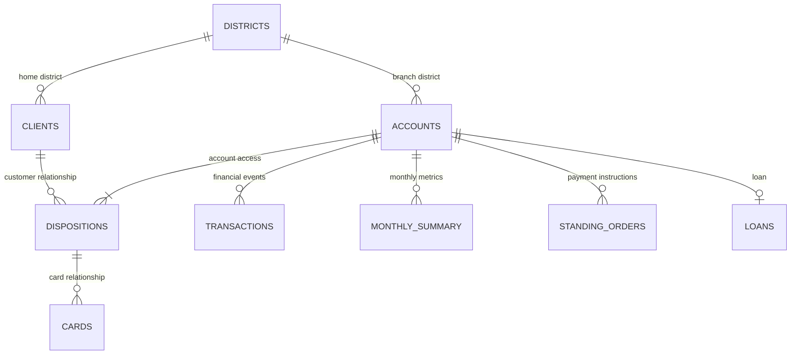
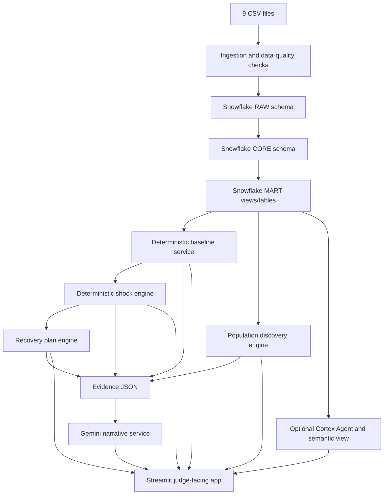

# Resilience Rewired — End-to-End System Design & Build Prompt

**Competition:** Sheridan Datathon 2026 — Tangerine Track  
**Team:** CTRL + ALT + WIN  
**Product:** Resilience Rewired  
**Purpose:** Give Gemini (or another coding agent) a complete implementation specification for the supplied banking dataset.

---

# 1. Product mission

Build a **Financial Resilience Intelligence Platform** for the Tangerine Resilience Rewired challenge.

For any valid `account_id` in the supplied 4,500 accounts, the product must:

1. **Know the customer:** Show typical monthly money-in, money-out, household bills, fixed costs, savings buffer, active loan payment and months of runway.
2. **Take a shock:** Apply job loss with EI, increased household bills, an unexpected repair, or combinations. Let the user change the shock size.
3. **Make a plan:** Provide a customer-specific emergency-fund goal and a backup plan for what to do if a shock happens.

At judging, a judge will choose an account and a scenario. The team must run the engine live and explain the new numbers and plan. The product must therefore work for any valid account, not only a pre-selected demo customer.

This is a scenario-based decision-support tool. It is **not** a loan-approval system, a credit-rejection model, or a claim that future events can be predicted with certainty.

## Competition judging criteria

| Criterion | Weight |
|---|---:|
| Discovery | 35% |
| Data Use | 25% |
| Communication | 25% |
| Impact | 15% |

## Required example shock cards from the competition README

- Customer loses their job; EI pays 55% of usual money-in for six months.
- Furnace dies; repair costs a full month of typical spending.
- Customer loses their job with EI at 55% and household bills rise by 15%.

The README's required submission items are a 2–3 minute demo video, a public repository or zip, a short write-up with the engine and biggest finding, and source links for external data used.

**Source of truth:** The supplied project `README.md` defines challenge requirements, source fields and official runway formulas. Do not silently replace those definitions with generic banking conventions.

---

# 2. Business questions the engine must answer

The competition README does not publish every possible judge question. It defines three capabilities and example shock cards. Translate those requirements into the following product questions.

## Customer understanding

- What is this customer's typical monthly money-in?
- What is typical monthly money-out?
- What are typical fixed costs and household bills?
- What is the savings buffer under the competition's definition?
- Does the account have a running loan and what is its monthly payment?
- Is typical money-in greater than typical money-out?
- How many months of runway does the account have?
- How have income, spending, balance and negative-balance days changed over the recent months?

## Shock simulation

- What if income falls to 55% of its usual level?
- What if household bills increase by 15%, 25% or a custom amount?
- What if an unexpected repair costs $1,000, $5,000 or one month of typical spending?
- What if income and expenses are shocked together?
- How much buffer remains after a one-off expense?
- What is the new monthly shortfall?
- What is the new runway?
- Does the buffer cover the user-selected shock duration?

## Recovery planning

- What emergency-fund target is being used?
- How far is the customer from that target?
- What historical monthly savings capacity is visible in the data?
- How long might it take to reach the target at that capacity?
- What if no positive savings capacity is visible?
- How much monthly spending adjustment would remove the post-shock shortfall?
- Which payment categories could be reviewed, without assuming they are automatically discretionary?
- What specific backup steps are relevant to the chosen scenario?

## Portfolio and discovery

- How many accounts have typical spending above typical money-in?
- How many have less than 3, 6 or 12 months of runway?
- How does this change under EI and household-bill shocks?
- Are customers with similar income levels experiencing different resilience because of their buffer or income variability?
- Are pre-loan financial patterns associated with the supplied `defaulted` flag?
- Which customer profiles are especially vulnerable to combined shocks?
- What important patterns are hidden by portfolio averages?

Do not turn the project into a generic CSV chatbot. The core product is an account-level financial resilience engine; natural-language Q&A is a supporting interface.

---

# 3. Dataset and relationships

The project folder should contain these nine CSV files:

| File | Expected rows | Grain |
|---|---:|---|
| `accounts.csv` | 4,500 | One account |
| `clients.csv` | 5,369 | One client |
| `dispositions.csv` | 5,369 | One client-account relationship |
| `cards.csv` | 892 | One card |
| `districts.csv` | 77 | One district |
| `transactions.csv` | 1,056,320 | One transaction |
| `monthly_summary.csv` | 185,326 | One account-month |
| `loans.csv` | 682 | One loan |
| `standing_orders.csv` | 6,471 | One standing-order instruction |

All monetary data is declared CAD in the competition README. Transaction history is 2020-01-01 through 2025-12-31. Monthly summaries cover each account's first to last transaction month, including quiet months.

## Relationship map



Rules:

- `dispositions.csv` is the bridge between `clients.csv` and `accounts.csv`.
- Filter `dispositions.type = 'owner'` when building the primary customer profile.
- `accounts.district_id` means account branch district.
- `clients.district_id` means customer home district. Keep both and rename them.
- `monthly_summary` key is (`account_id`, `month`).
- `partner_account` and `to_account` are external/destination account numbers, not internal `account_id` values.
- Aggregate one-to-many tables before joining them. Never join all raw transactions, monthly summaries and standing orders together; that multiplies rows.

## Critical data caveats

- `money_in` includes cash deposits, transfers, pensions and interest. It is not confirmed employment income. The README's 55% EI example is a competition simplification; implement it exactly in Judge Mode, but do not describe `money_in` as verified salary.
- `transactions.purpose` can be blank. Do not invent categories for unlabeled transactions.
- Transaction rows within one date are not in reliable time order. Do not claim to reconstruct intraday sequences.
- Keep `partner_account`, `to_account` and bank codes as strings.
- `standing_orders.csv` is an undated end-of-data snapshot with no frequency or effective-date field. Do not assume every order is monthly or existed throughout the historical period.
- Do not add standing-order amounts to `money_out`; that risks double-counting actual transactions.
- District data is contextual area-level data, not an individual customer's employment or financial state. Do not relabel original district geography as Canadian municipal geography without a valid mapping.
- Loan status C means running and OK so far; D means running, client in debt. `defaulted=1` for B and D.
- The README defines `amount = duration_months × monthly_payment`; do not treat amount as outstanding loan balance.
- `days_below_zero` is a count of days ending negative, not every possible intraday overdraft event.

---

# 4. Official customer metrics — implement exactly

The official financial calculations must be deterministic Python or SQL. **Never ask an LLM to calculate these metrics.**

For a selected account, sort its `monthly_summary` rows chronologically by `month`.

| Symbol | Display label | Official calculation |
|---|---|---|
| `I` | Typical monthly money-in | Median of `money_in` |
| `F` | Typical fixed costs | Median of row-wise `household_bills + insurance + loan_payments` |
| `S` | Typical monthly spending | Median of `money_out` |
| `B` | Savings buffer | Mean of `avg_daily_balance` over the account's last 6 monthly rows |
| `H` | Typical household bills | Median of `household_bills` |
| `P` | Active loan payment | `monthly_payment` if loan is still running at end of 2025, otherwise 0 |

For `F`, sum the three cost columns **per month first**, then take the median:

```python
monthly["fixed_costs_row"] = (
    monthly["household_bills"]
    + monthly["insurance"]
    + monthly["loan_payments"]
)
F = monthly["fixed_costs_row"].median()
```

Do not add the median of each component separately.

For `B`, sort by month, select exactly the last six monthly rows for that account, and average `avg_daily_balance`.

The Phase 1 audit verified 448 loans running at end of 2025 (statuses C and D). Confirm this against the supplied data.

`F` is displayed but is not independently included in the runway formula. `P` is displayed as loan context; loan payments are already included in `money_out`, so never add P to spending a second time.

---

# 5. Official runway and scenario engine

## Official Judge Match formula

```text
buffer_left = B - one_off_costs
gap = spending_after_shock - income_after_shock

if buffer_left <= 0:
    runway = 0
elif gap <= 0:
    runway = "no shortfall (120+)"
else:
    runway = min(buffer_left / gap, 120)
```

Round numeric runway to one decimal place.

### Required Judge Mode scenarios

**Baseline**

```text
income_after_shock = I
spending_after_shock = S
one_off_costs = 0
```

**Job loss with EI at 55%**

```text
income_after_shock = 0.55 * I
spending_after_shock = S
one_off_costs = 0
```

**Furnace / repair**

The README example says a repair costs one full month of typical spending:

```text
income_after_shock = I
spending_after_shock = S
one_off_costs = S
```

**Combined job loss + bills increase by 15%**

```text
income_after_shock = 0.55 * I
spending_after_shock = S + (0.15 * H)
one_off_costs = 0
```

All inputs must be adjustable in the UI. Add custom combined shocks without altering the official presets.

### Duration handling — keep two modes separate

The README describes EI at 55% for six months, but its official runway equation is a monthly gap calculation.

Implement two clearly labelled outputs:

1. **Judge Match Runway:** exact official formula above. This is the primary figure to match the judging calculation.
2. **Shock-Period Projection:** optional month-by-month view showing the estimated buffer after the specified shock duration. For a six-month scenario, calculate the cumulative monthly gap over six months. If the app projects beyond the shock period, require explicit user input for post-shock income and spending recovery assumptions. Never silently assume the customer gets a new job or returns to 100% income.

Do not replace the official Judge Match Runway with a custom duration model.

---

# 6. Recomputed discoveries to reproduce

The following numbers were recalculated directly from the supplied CSVs using account-level grouping and the README metric definitions. Reproduce them in a script before displaying them as headline findings.

## Portfolio baseline

| Metric | Recomputed result |
|---|---:|
| Accounts | 4,500 |
| Median account-level typical money-in (`I`) | $7,568.26 |
| Median account-level typical money-out (`S`) | $7,388.65 |
| Median account-level fixed costs (`F`) | $1,774.17 |
| Median account-level household bills (`H`) | $1,536.68 |
| Median account-level six-row buffer (`B`) | $22,325.10 |
| Accounts with median `S > I` | 1,181 (26.2%) |
| Accounts with `B <= 0` | 23 |

## Runway under official scenarios

| Scenario | Below 6 months | Share | Below 12 months | Share |
|---|---:|---:|---:|---:|
| Baseline | 122 | 2.7% | 241 | 5.4% |
| EI / job loss at 55% | 1,596 | 35.5% | 2,736 | 60.8% |
| EI 55% + household bills +15% | 1,752 | 38.9% | 2,902 | 64.5% |
| One-off repair costing `S` | 395 | 8.8% | 578 | 12.8% |

In baseline, 3,315 accounts have a positive buffer and no positive monthly shortfall under the exact formula. The formula checks `buffer_left <= 0` before checking whether the monthly gap is non-positive.

Candidate headline:

> A portfolio can look stable on ordinary monthly cash flow while an income shock changes the resilience picture. Under the challenge's 55% EI assumption, 1,596 of 4,500 accounts have less than six months of calculated runway; with a simultaneous 15% household-bill increase, this rises to 1,752.

This is a scenario calculation under the challenge's assumptions, not a prediction that those customers will lose their jobs.

## Exploratory loan finding

Loan status counts:

| Status | Meaning | Count |
|---|---|---:|
| A | Finished, repaid | 203 |
| B | Finished, NOT repaid | 31 |
| C | Running, OK so far | 403 |
| D | Running, client in debt | 45 |

There are 76 rows with `defaulted=1` (B and D).

For 615 loan accounts with six complete calendar months before loan origination:

| Pre-loan buffer group | `defaulted=1` | Rate |
|---|---:|---:|
| Lowest buffer quartile | 35 / 154 | 22.7% |
| Highest buffer quartile | 8 / 154 | 5.2% |

This is an approximately 4.4x difference in observed rates between the lowest- and highest-buffer quartiles.

Other exploratory medians over the six complete pre-loan months:

| Feature | `defaulted=1` | `defaulted=0` |
|---|---:|---:|
| Pre-loan buffer | $18,111.64 | $26,146.05 |
| Median monthly money-in | $11,646.65 | $13,874.07 |
| Income coefficient of variation | 0.680 | 0.173 |

The coefficient of variation is the population standard deviation of monthly money-in divided by its mean across those six pre-loan months.

A temporal check found 27 of 76 `defaulted=1` loan accounts had at least one negative-balance month before origination, compared with 0 of 606 `defaulted=0` accounts. In the six months immediately before origination, the count was 21 of 76.

**Limitations:** This is association, not causation. `defaulted=1` combines finished-not-repaid and running-in-debt loans. The dataset does not provide a precise loan-default event date. Use only pre-origination features in early-warning analysis. Do not use lifetime negative-balance history to predict loan status because it may contain post-origination or post-outcome information. Never market this exploratory result as a validated credit-approval model.

**Data-audit correction:** Some numbers in an earlier Phase 1 draft conflict with a fresh account-level recomputation. In particular, median account-level `money_out` is $7,388.65 and 1,181 accounts (26.2%) have `S > I`. Reproduce all headline statistics from raw CSVs; do not hardcode conflicting old figures.

---

# 7. Recommended system architecture



## Technology stack

| Layer | Technology | Responsibility |
|---|---|---|
| Data warehouse | Snowflake | Store source tables and curated analytical data |
| Transformation | Snowflake SQL; Snowpark Python where useful | Clean, join and derive data features |
| Financial calculations | Python | Exact baseline, shock and plan calculations |
| Frontend | Streamlit | Interactive judge-facing application |
| Charts | Plotly | Cash-flow trends, runway, shock comparisons and evidence charts |
| AI explanation | Gemini API | Explain already-computed, verified results |
| Optional natural-language SQL | Snowflake Cortex Agents + Semantic View | Answer structured questions over approved curated metrics |
| Local fallback | Pandas + DuckDB | Keep the app running when Snowflake is unavailable |

**Snowflake must be a real data layer, not a decorative integration.** However, do not make Snowflake credentials a hard dependency for local development or the judge demo. Implement a local CSV/DuckDB mode and a Snowflake mode behind the same repository interface. Never fake a successful connection.

---

# 8. Snowflake data architecture

Create the database and schemas:

```text
RESILIENCE_REWIRED
├── RAW
│   ├── ACCOUNTS_RAW
│   ├── CLIENTS_RAW
│   ├── DISPOSITIONS_RAW
│   ├── CARDS_RAW
│   ├── DISTRICTS_RAW
│   ├── TRANSACTIONS_RAW
│   ├── MONTHLY_SUMMARY_RAW
│   ├── LOANS_RAW
│   └── STANDING_ORDERS_RAW
├── CORE
│   ├── DIM_ACCOUNT
│   ├── DIM_CLIENT
│   ├── BRIDGE_DISPOSITION
│   ├── DIM_DISTRICT
│   ├── DIM_CARD
│   ├── FACT_TRANSACTION
│   ├── FACT_ACCOUNT_MONTH
│   ├── FACT_LOAN
│   └── FACT_STANDING_ORDER
├── MART
│   ├── ACCOUNT_BASELINE
│   ├── ACCOUNT_MONTHLY_FEATURES
│   ├── ACCOUNT_SHOCK_EXPOSURE
│   ├── LOAN_PREORIGINATION_FEATURES
│   ├── POPULATION_RESILIENCE_SUMMARY
│   └── DISCOVERY_EVIDENCE
└── SEMANTIC
    └── FINANCIAL_RESILIENCE_SEMANTIC_VIEW
```

### Ingestion requirements

- Use a named internal stage and CSV file format.
- Load with Snowflake `PUT` and `COPY INTO`, or another supported Snowflake ingestion path.
- Preserve primary/foreign keys and parse numeric/date fields explicitly.
- Keep external bank/account reference columns as strings.
- Preserve the original raw data. Create CORE/MART objects separately.
- Record file names, row counts, load status, timestamp and errors.
- Make loading repeatable and idempotent; do not append duplicate records on each run.
- Validate row counts and all important relationships after loading.

### Curated baseline object

Build one row per account with at least:

```text
ACCOUNT_ID
OWNER_CLIENT_ID
BRANCH_DISTRICT_ID
HOME_DISTRICT_ID
ACCOUNT_OPENED
STATEMENT_FREQUENCY
TYPICAL_MONEY_IN_I
TYPICAL_FIXED_COSTS_F
TYPICAL_SPENDING_S
BUFFER_B
HOUSEHOLD_BILLS_H
ACTIVE_LOAN_PAYMENT_P
MEDIAN_MONTHLY_NET_CASHFLOW
LAST_6M_INCOME_VOLATILITY
LAST_12M_DEFICIT_MONTH_SHARE
LAST_12M_NEGATIVE_BALANCE_MONTH_SHARE
RUNWAY_BASELINE_MONTHS
DATA_QUALITY_FLAGS
```

Challenge-mandated fields must use the exact definitions. Additional feature columns must be labelled as analytical extensions and must not replace official fields.

## Semantic View and Cortex

If the team has access to Snowflake Cortex:

- Define a business-focused Semantic View over approved MART data.
- Explain business terms such as typical money-in, spending, fixed costs, buffer, shortfall, runway, active loan and scenario.
- Define safe relationships and metric grains.
- Add verified example questions and SQL.
- Use a Cortex Agent with structured analytics capability if available.
- Use read-only permissions on approved views.

Example structured questions:

- How many accounts have under six months of runway under the EI 55% scenario?
- Which accounts have a negative typical monthly cash-flow position?
- How does runway vary by resilience segment?
- What is the defaulted-flag rate by pre-loan buffer quartile?
- How many accounts have repeated negative-balance months in the last year?

Cortex should be used for questions resolvable through structured data. Do not rely on a text-to-SQL agent to discover broad patterns, prove causality or run the official shock calculation. Python/SQL discovery and the deterministic engine own those responsibilities.

If Cortex access, region availability or setup blocks implementation, do not delay the product. Use approved SQL query functions and Gemini explanations as fallback.

---

# 9. Application screens

## Screen 1 — Portfolio Overview / Main Discovery

Show:

- Total accounts.
- Median typical money-in and spending.
- Median buffer.
- Number/share with `S > I`.
- Baseline runway distribution.
- Accounts below 6 months under EI 55%.
- Accounts below 6 months under combined shock.
- Three validated discovery cards.

Charts:

- Baseline vs scenario runway distribution.
- Population share below 3, 6 and 12 months.
- Cash-flow vs buffer scatter plot.
- Segment distribution, if defensible segments are built.

Every KPI must show denominator, time window and calculation definition.

## Screen 2 — Customer Explorer

- Search or enter any `account_id`.
- Validate account ID.
- Load the primary owner profile.
- Show I, F, S, B, H and P.
- Show baseline runway.
- Display the six rows used for B.
- Display 6–12 month trend charts for money-in, money-out, net flow, average balance and days below zero.
- Explain metrics via help text.
- Show data-quality warnings.
- Do not send birth dates or full transaction history to an LLM.

## Screen 3 — Shock Simulator

Preset cards:

1. Baseline.
2. Job loss / EI at 55%.
3. Furnace / repair equal to S.
4. Job loss + household bills +15%.
5. Custom.

Controls:

- Income replacement percentage / multiplier.
- Household-bill change percentage.
- One-off emergency cost in CAD.
- Optional duration in months.
- Optional post-shock recovery assumptions.

Show before and after:

- Money-in and money-out.
- Household bills.
- Monthly gap / surplus.
- Buffer before shock.
- Buffer after one-off cost.
- Official Judge Match Runway.
- Optional shock-period ending buffer.
- Difference from baseline.

Update calculations immediately. Do not require an LLM call to update numbers.

## Screen 4 — Recovery Planner

The README requires a goal plan but does not prescribe an emergency-fund target formula. Make all planning assumptions explicit and editable.

Suggested product default:

- Target months is user adjustable, default 3.
- Use F as the initial essential-cost proxy when F > 0.
- If F = 0, warn that fixed costs may be unobserved and require confirmation of an essential monthly expense amount. Do not silently assume there are no real-world essentials.
- `emergency_target = target_months × confirmed_essential_monthly_cost`.
- `funding_gap = max(0, emergency_target - current_buffer)`.

For savings capacity, use a clearly labelled recent historical statistic, such as the median of `money_in - money_out` over the most recent six monthly rows. Use `max(0, that value)` as the suggested starting capacity. It is not a guaranteed future saving amount.

- If capacity > 0, `months_to_goal = ceil(funding_gap / monthly_savings_capacity)`.
- If capacity <= 0 while funding gap > 0, explain that recent history does not show positive savings capacity. Offer a what-if expense adjustment rather than fabricating a timeline.
- Let the user change the monthly savings amount and target duration.

Backup plan:

- Monthly post-shock shortfall.
- One-off cost and remaining buffer.
- Required monthly adjustment: `max(0, spending_after_shock - income_after_shock)`.
- Possible categories to review based on historical fields.
- Do not assume cash withdrawals, card withdrawals or unlabelled transfers are definitely discretionary.
- Standing orders are an undated snapshot; show them as possible commitments to review, not guaranteed monthly obligations.
- Combine deterministic actions with optional AI wording.

Clearly label these as product-planning assumptions, not official judge formulas.

## Screen 5 — Population Discovery

Build transparent segments and features, not an opaque credit score.

Possible features:

- Baseline monthly gap.
- Buffer months (`B / S` when S > 0).
- Recent income variability.
- Share of recent deficit months.
- Share of recent months with negative balance days.
- EI 55% runway.
- Combined-shock runway.
- Fixed-cost share where meaningful.

Discovery tracks:

1. Shock vulnerability.
2. Income instability.
3. Pre-loan indicators associated with `defaulted`.
4. Persistent deficits while buffers remain positive.
5. District context differences, with ecological-inference caveats.

For loan analysis:

- Cut off features at `loan_start`.
- Use only data available before origination.
- Exclude lifetime data that may contain post-loan events.
- Report complete-history sample size and missing-window exclusions.
- Report effect sizes and uncertainty.
- Do not imply causation.
- Do not use the output to approve or reject customers.

## Screen 6 — Evidence Storytelling

Every finding must be an evidence card with:

1. Headline.
2. Business question.
3. Metric definition.
4. Sample size and denominator.
5. Time window.
6. Method.
7. Result and comparison.
8. Chart.
9. Why it matters.
10. Limitations and alternative explanations.
11. Potential action.

Narrative sequence:

**Question → Surprising result → Evidence → Who is affected → Possible action → What remains uncertain.**

Do not add a chart just because it looks impressive. Every chart must answer a defined question.

## Screen 7 — AI Business Q&A

Suggested user questions:

- Explain this customer's financial position.
- What happens if their money-in falls to 55%?
- Compare baseline and combined-shock runway.
- How much emergency funding would close their goal gap?
- Which accounts have fewer than six months of EI shock runway?
- What differentiates the lowest-buffer loan quartile?
- What evidence supports the main discovery?
- What limitations should a bank decision-maker understand?

Route questions:

- Account metric → deterministic baseline service.
- Scenario → deterministic shock engine.
- Plan → recovery planner.
- Aggregate metric → approved SQL / Cortex semantic view.
- Narrative explanation → Gemini receives verified evidence JSON.

AI must not invent numbers, override metrics, generate arbitrary SQL for execution, or claim correlation proves causation. If data cannot answer a question, say so.

---

# 10. Core service contracts

Keep calculation logic separate from the UI and AI code.

```python
def get_customer_profile(account_id: int) -> dict:
    """Return the primary owner and account context."""

def calculate_official_baseline(account_id, monthly_rows, loan_row=None) -> dict:
    """Return I, F, S, B, H, P using README definitions."""

def calculate_judge_runway(
    buffer: float,
    income_after_shock: float,
    spending_after_shock: float,
    one_off_costs: float = 0.0,
) -> dict:
    """Return buffer_left, gap, runway_months and display label."""

def run_scenario(baseline: dict, scenario: dict) -> dict:
    """Return deterministic scenario calculations."""

def project_shock_period(baseline: dict, scenario: dict) -> dict:
    """Optional duration-based projection, separate from Judge Match Runway."""

def build_goal_plan(baseline: dict, planning_inputs: dict) -> dict:
    """Return target, funding gap, saving capacity and estimated timeline."""

def build_backup_plan(baseline: dict, scenario_result: dict) -> dict:
    """Return monthly gap, required adjustment and review candidates."""

def build_population_discoveries(data) -> list[dict]:
    """Return reproducible findings with evidence and caveats."""
```

Use typed dataclasses or Pydantic models for baseline, scenario and results. Use controlled rounding or `Decimal` for currency display.

## Scenario object example

```json
{
  "scenario_id": "JOB_LOSS_EI_55",
  "name": "Job loss with EI",
  "income_multiplier": 0.55,
  "household_bill_increase_pct": 0.0,
  "one_off_cost": 0.0,
  "shock_duration_months": 6,
  "post_shock_income_multiplier": null,
  "post_shock_spending_multiplier": null,
  "mode": "judge_match"
}
```

Duration belongs to the optional timeline projection. It must not alter the official Judge Match Runway calculation.

---

# 11. Gemini narrative service

Send only the minimum aggregated evidence needed. Do not send all 1.06 million transactions to an LLM.

Example input:

```json
{
  "account_id": 12345,
  "baseline": {
    "typical_money_in": 5000,
    "typical_spending": 4600,
    "fixed_costs": 2100,
    "buffer": 8000,
    "household_bills": 1200,
    "active_loan_payment": 500
  },
  "scenario": {
    "name": "Job loss plus 15% household-bill increase",
    "income_multiplier": 0.55,
    "household_bill_increase_pct": 0.15,
    "one_off_cost": 0
  },
  "computed_result": {
    "monthly_income_after_shock": 2750,
    "monthly_spending_after_shock": 4780,
    "monthly_gap": 2030,
    "buffer_left": 8000,
    "judge_match_runway_months": 3.9
  },
  "limitations": [
    "Money-in includes transfers and deposits and is not confirmed payroll income."
  ]
}
```

The values above are illustrative only.

Require structured output:

```json
{
  "headline": "The combined shock creates a monthly cash-flow gap.",
  "plain_language_explanation": "...",
  "key_drivers": ["..."],
  "recommended_actions": ["..."],
  "limitations": ["..."],
  "numbers_used_without_modification": {
    "monthly_gap": 2030,
    "runway_months": 3.9
  }
}
```

Validate the response. If Gemini changes or invents values, discard the generated figures and use deterministic explanation templates. Numeric UI values always come from Python/SQL calculations.

---

# 12. Suggested repository structure

```text
resilience-rewired/
├── app.py
├── README.md
├── requirements.txt
├── .env.example
├── .gitignore
├── data/                         # supplied CSVs locally if appropriate
├── config/
│   ├── settings.py
│   └── scenarios.py
├── src/
│   ├── data/
│   │   ├── loader.py
│   │   ├── validation.py
│   │   ├── local_repository.py
│   │   └── snowflake_repository.py
│   ├── services/
│   │   ├── customer_profile.py
│   │   ├── baseline_metrics.py
│   │   ├── shock_engine.py
│   │   ├── timeline_projection.py
│   │   ├── recovery_planner.py
│   │   ├── discovery_engine.py
│   │   ├── evidence_builder.py
│   │   ├── business_question_router.py
│   │   └── ai_narrative.py
│   ├── ui/
│   │   ├── overview.py
│   │   ├── customer_explorer.py
│   │   ├── shock_simulator.py
│   │   ├── recovery_planner.py
│   │   ├── discoveries.py
│   │   └── methodology.py
│   └── utils/
│       ├── formatting.py
│       └── logging.py
├── sql/
│   ├── 01_create_database_and_schemas.sql
│   ├── 02_stage_and_file_format.sql
│   ├── 03_create_raw_tables.sql
│   ├── 04_load_csv_files.sql
│   ├── 05_create_core_views.sql
│   ├── 06_create_mart_views.sql
│   └── 07_create_semantic_view.sql
├── scripts/
│   ├── audit_data.py
│   ├── load_snowflake.py
│   ├── build_marts.py
│   └── reproduce_findings.py
└── tests/
    ├── test_data_quality.py
    ├── test_baseline_metrics.py
    ├── test_shock_engine.py
    ├── test_recovery_planner.py
    └── test_discovery_results.py
```

Adapt as needed, but keep the calculation logic separate from presentation and AI code.

---

# 13. Testing and data quality requirements

## Data checks

- Confirm all expected files exist.
- Record actual row counts.
- Check primary-key duplicates.
- Check uniqueness of (`account_id`, `month`) in monthly summary.
- Check foreign-key integrity.
- Check one owner disposition per account.
- Check at most one loan per account.
- Parse numeric and date columns correctly.
- Preserve unknown/missing values instead of fabricating them.
- Reconcile `money_in` against its four components.
- Reconcile `money_out` against its seven components.
- Compare transaction aggregates to monthly summaries within a documented tolerance.
- Ensure at least six monthly records exist before calculating B; otherwise show a data-quality warning.

## Unit tests for official formulas

Test at least:

1. I uses median, not mean.
2. S uses median, not mean.
3. F is the median of row-wise fixed-cost sums.
4. B averages exactly the last six chronological rows.
5. H uses median household bills.
6. P is active only when the loan is running at end of 2025.
7. `buffer_left <= 0` returns zero runway even if the gap is non-positive.
8. Positive buffer and `gap <= 0` returns `120+`.
9. Positive buffer and positive gap returns buffer divided by gap, capped at 120.
10. Numeric runway rounds to one decimal.
11. Job loss applies exactly `0.55 × I`.
12. Combined shock applies exactly `S + 0.15 × H`.
13. Furnace repair subtracts S as the one-off expense.
14. Invalid account ID returns a clear message.
15. Slider changes recalculate without an AI call.

Also add an integration test using a real account ID and independently calculated expected values.

## Reproducible findings

Create `scripts/reproduce_findings.py` to produce JSON/CSV evidence with:

- Metric definitions.
- Scenario parameters.
- Counts and denominators.
- Distribution summaries.
- Loan analysis sample inclusion/exclusion counts.
- Buffer quartile thresholds.
- Defaulted-flag counts and rates.
- Date windows and limitations.

All dashboard and pitch statistics must come from the reproducible script or shared calculation functions. Do not manually hardcode headline results.

---

# 14. Visual and presentation requirements

Build a premium, readable fintech product—not a generic admin dashboard.

Suggested style:

- Deep navy / charcoal base.
- Tangerine-orange accent.
- Warm off-white content surfaces.
- Large, readable financial KPIs.
- Clear status and warning labels.
- Restrained cards and annotations.
- Charts that remain legible when projected to judges.

## Five-minute judging flow

1. **Minute 1 — Discovery:** Present the strongest validated population finding.
2. **Minutes 2–4 — Live judge twist:** Enter the judge's account ID, show baseline, apply their scenario, explain new runway and show the personalized plan.
3. **Minute 5 — Questions:** Explain methodology, assumptions, limitations and impact.

Candidate opening:

> A monthly balance is a snapshot, not a measure of resilience. We built an engine that shows how long a customer can withstand a financial shock, what changes that runway, and what practical plan could help.

The app must continue to work if Gemini or Cortex is unavailable. Deterministic calculations and the live demo take priority over AI.

---

# 15. Build order

### P0 — Mandatory functionality

- Read the supplied README and inspect all nine CSVs.
- Implement data loading and validation.
- Implement exact official baseline metrics.
- Implement exact official runway.
- Implement three supplied shock presets.
- Build account ID search for all accounts.
- Build customer goal and backup planning.
- Write unit tests.

### P1 — Discovery and storytelling

- Reproduce the population scenario results.
- Validate the pre-loan findings with strict time cutoffs.
- Create transparent resilience segments.
- Build evidence cards with charts, denominators and caveats.
- Prepare the main discovery story.

### P2 — Technology differentiators

- Configure Snowflake RAW, CORE and MART.
- Load CSVs through stage and `COPY INTO`.
- Create semantic view.
- Add Cortex Agent only if account access and setup are available.
- Connect Gemini to verified evidence JSON.
- Add natural-language business Q&A.

### P3 — Submission polish

- Test many account IDs and every scenario.
- Add methodology and assumptions screen.
- Prepare demo video, code repository and write-up.
- Credit the dataset and all outside sources.

---

# 16. Acceptance criteria — the product is not done until these pass

- [ ] Any valid one of the 4,500 account IDs can be searched.
- [ ] Primary account owner is joined correctly.
- [ ] Official baseline metrics match README formulas.
- [ ] Buffer uses the last six chronological monthly rows.
- [ ] Loan payment is displayed correctly and not double-counted.
- [ ] All three sample twists work live.
- [ ] Shock inputs can be edited.
- [ ] Judge Match Runway is distinguished from optional duration projections.
- [ ] Goal assumptions are visible and editable.
- [ ] A savings goal and backup plan are produced.
- [ ] Population discoveries show denominator, method and limitations.
- [ ] Loan early-warning analysis uses pre-origination data only.
- [ ] Charts answer business questions.
- [ ] The app works without Gemini.
- [ ] A local fallback works without Snowflake.
- [ ] Secrets are not hardcoded or committed.
- [ ] The app can be launched cleanly for the judge demo.

---

# 17. MASTER BUILD PROMPT — GIVE THIS TO GEMINI

## ROLE

You are the lead full-stack engineer, data engineer, financial analytics architect and product designer for CTRL + ALT + WIN at Sheridan Datathon 2026.

Build the working end-to-end product **Resilience Rewired** in the currently opened project folder using the supplied CSV files and this system design document.

Do not merely write another plan. Inspect files, create and edit code, create SQL scripts, implement the calculations, build the Streamlit application, write tests, and document how to run it.

## SOURCE OF TRUTH

1. Read the actual `README.md` in the project folder completely before coding.
2. Inspect all nine CSVs: headers, types, row counts, keys, relationships and missing values.
3. Treat the competition README as authoritative for challenge formulas and definitions.
4. Treat this document as the product and architecture specification.
5. Recompute headline statistics from raw CSVs. Do not trust manually copied numbers if they cannot be reproduced.
6. If an earlier report conflicts with the source data or README, document the discrepancy and use reproducible source-data calculations.

## BUILD THE PRODUCT

Create a Streamlit financial resilience app with:

- Portfolio Overview and main discovery.
- Customer Explorer for any account ID.
- Shock Simulator with the three official presets and custom shocks.
- Personalized Recovery Planner.
- Population Discovery and loan pre-origination analysis.
- Evidence and Methodology page.
- Optional AI Business Q&A.

Use Python for all official calculations. Use Snowflake as a real warehouse when credentials are available. Use local CSV/DuckDB mode when they are not. Use Gemini only to explain verified outputs. Cortex Agents and a Semantic View are optional structured Q&A integrations, not a replacement for the calculation engine.

## MUST IMPLEMENT

1. Full data ingestion, validation and correct joins.
2. Official I, F, S, B, H and P calculations.
3. Exact official Judge Match Runway.
4. Baseline, EI 55%, repair and combined shock scenarios.
5. Adjustable shock parameters.
6. Optional duration projection clearly separated from official runway.
7. Emergency-fund target with editable assumptions.
8. Savings-capacity estimate based on visible historical cash flow.
9. Shock-specific backup plan.
10. Reproducible population discoveries.
11. Polished and fast judge-facing Streamlit interface.
12. Tests for formulas, edge cases and real-account outputs.
13. Snowflake SQL setup, ingestion, CORE/MART views and optional semantic view.
14. `.env.example`, `requirements.txt`, `.gitignore` and full project README.
15. Demo runbook and short pitch based only on validated results.

## NON-NEGOTIABLE RULES

- Never use an LLM to calculate or override financial values.
- Do not add F or P again to spending.
- Do not confuse branch district with home district.
- Do not duplicate transactions through authorized-user joins.
- Do not add standing-order snapshots to actual spending.
- Do not assume `money_in` is employment salary.
- Do not infer intraday order from same-date transactions.
- Do not use post-origination or lifetime features to predict pre-loan outcomes.
- Do not claim correlation proves causation.
- Do not create an opaque credit score or make loan decisions.
- Do not invent data fields or external facts.
- Never hardcode final discovery numbers; reproduce them.
- Never fake a Snowflake or Gemini connection.
- Keep the app functional if optional AI services fail.

## WORKING STYLE

- Inspect the existing project folder first and preserve useful work.
- Build in P0 → P1 → P2 → P3 order.
- Keep the app runnable at every milestone.
- Run tests after each phase.
- Do not leave placeholders in core functionality.
- If an optional integration is unavailable, implement its fallback and continue.
- Do not stop after writing architecture documentation; implement the project.
- Report the files created, tests run, commands to launch, and any remaining limitations.

**The final product is judged by whether it can answer an unexpected account-and-shock question live, calculate the answer correctly, explain the evidence and provide a credible personalized plan—not by how many technologies it uses.**

---

# 18. Technical references

Competition definitions and source credits are in the supplied `README.md`.

Snowflake:
- `COPY INTO` loading: https://docs.snowflake.com/en/sql-reference/sql/copy-into-table
- Semantic Views: https://docs.snowflake.com/en/user-guide/views-semantic/overview
- Cortex Analyst and current Cortex Agents transition guidance: https://docs.snowflake.com/en/user-guide/snowflake-cortex/cortex-analyst
- Cortex Agents REST API: https://docs.snowflake.com/en/user-guide/snowflake-cortex/cortex-agents-rest-api
- Streamlit in Snowflake: https://docs.snowflake.com/en/en/developer-guide/streamlit/getting-started/overview

Dataset credit required by the challenge:
- PKDD'99 Financial dataset: https://relational.fel.cvut.cz/dataset/Financial

Canadian shock-sizing sources listed in the challenge README (optional; link any used):
- CPI: https://www150.statcan.gc.ca/t1/tbl1/en/tv.action?pid=1810000401
- CMHC average rents: https://www150.statcan.gc.ca/t1/tbl1/en/tv.action?pid=3410013301
- Labour Force Survey: https://www150.statcan.gc.ca/t1/tbl1/en/tv.action?pid=1410028701
- Employment Insurance: https://www.canada.ca/en/services/benefits/ei/ei-regular-benefit.html
- Average weekly earnings: https://www150.statcan.gc.ca/t1/tbl1/en/tv.action?pid=1410022301
