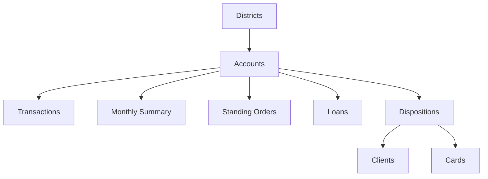

# Phase 2 Deep Dive
## Sheridan Datathon 2026 — Tangerine: Resilience Rewired

**Team:** CTRL + ALT + WIN  
**Research stage:** Initial dataset inspection and preliminary discovery  
**Dataset:** Anonymized banking data supplied for the datathon  
**Currency:** CAD, as specified in the challenge README  
**Important:** This document records preliminary analysis and hypotheses. It is not a final validated research report.

---

## 1. Executive summary

The Tangerine Resilience Rewired challenge asks teams to build a financial resilience engine that can:

1. Take an `account_id` and summarize the customer's income, bills, fixed costs, savings buffer and runway.
2. Apply configurable financial shocks, such as job loss, higher household bills and unexpected repairs.
3. Produce a personalized emergency-fund goal and a backup plan if a shock occurs.

The judging scenario is live: a judge selects an account and a twist, and the team must run the engine and explain the result.

Our initial analysis suggests a potentially important story:

> Financial resilience is not captured by income or account balance alone. Cash-flow stability, available buffer and the size of a financial shock all matter.

Two preliminary findings deserve deeper investigation:

- Under the challenge's simplified job-loss scenario, a substantial share of accounts may have less than six months of calculated runway.
- In a subset of loan accounts with six complete pre-origination months, the lowest pre-loan balance-buffer quartile had a higher observed default rate than the highest-buffer quartile.

These are exploratory results. They do not establish causation and must be independently reproduced and validated before being used as headline claims.

---

## 2. Challenge requirements

### 2.1 Required product capabilities

| Capability | Required behaviour |
|---|---|
| Know the customer | Accept an account ID and show typical income, bills, fixed costs, buffer and runway |
| Take a shock | Change income and/or spending using adjustable shock assumptions |
| Make a plan | Generate an emergency-fund goal plan and a backup plan |

### 2.2 Published judging weights

| Criterion | Weight |
|---|---:|
| Discovery | 35% |
| Data Use | 25% |
| Communication | 25% |
| Impact | 15% |

### 2.3 Live judging format

The challenge README describes approximately five minutes:

- 1 minute: pitch and biggest finding.
- 3 minutes: judge selects an account and twist; team runs the engine live.
- 1 minute: questions.

Example twists include job loss with EI at 55% of usual income, a repair costing one month of typical spending, and job loss combined with a 15% increase in household bills.

---

## 3. Dataset inventory

The supplied dataset contains nine related CSV files.

| File | Rows | Main purpose |
|---|---:|---|
| `accounts.csv` | 4,500 | Bank accounts, district and statement frequency |
| `transactions.csv` | 1,056,320 | Individual account transactions, 2020–2025 |
| `monthly_summary.csv` | 185,326 | Monthly account-level income, spending and balance measures |
| `loans.csv` | 682 | Loan amounts, terms, status and default indicator |
| `clients.csv` | 5,369 | Client attributes |
| `dispositions.csv` | 5,369 | Links clients to accounts; owner or authorized user |
| `cards.csv` | 892 | Cards linked to dispositions |
| `standing_orders.csv` | 6,471 | Snapshot of recurring payment instructions |
| `districts.csv` | 77 | District-level demographic and economic measures |

### 3.1 Relationship structure



**Join caution:** An account can have an owner and authorized users. For a single customer-account profile, use the owner disposition unless the use case explicitly requires authorized users. Joining all dispositions without handling relationship type can duplicate account-level financial records.

---

## 4. Data quality and interpretation notes

The initial structural checks reported:

- No duplicate records found in the supplied tables.
- Transaction, monthly-summary, loan, standing-order and disposition links to accounts were valid.
- Monthly income components reconciled to `money_in`.
- Monthly spending components reconciled to `money_out`.

These checks should be rerun in the team's reproducible analysis notebook before final submission.

### 4.1 Important limitations

1. **Unlabelled transactions:** The initial inspection reported 535,314 transactions with blank purpose. Do not infer a precise spending category for these records.
2. **Income is not necessarily employment income:** The dataset records cash deposits, transfers, pensions and interest. It does not provide a definitive payroll/employer-income field.
3. **Household bills can be zero in observed summaries:** The initial inspection reported 1,225 accounts with median household bills of zero, including 162 with a household-bill standing order. Zero observed bills should not automatically be interpreted as zero rent or housing costs.
4. **Transaction ordering:** Transactions have dates but no reliable within-day ordering. The README explicitly says rows within the same day are not in time order. Avoid intraday event-sequence claims.
5. **Geographic interpretation:** The data is credited to the PKDD'99 Financial dataset from CTU Prague. The challenge README says monetary fields are CAD, but the original district geography should not be presented as Canadian municipal geography without qualification.
6. **Loan outcomes:** Status C means running and OK so far; it is not a completed successful repayment. Status D means running, client in debt. The `defaulted` flag includes B and D.

---

## 5. Judge-aligned customer metrics

The challenge README specifies the following definitions. These should be implemented exactly in the live engine to match judging calculations.

| Symbol | Metric | Challenge definition |
|---|---|---|
| I | Typical monthly money in | Median `money_in` for the account |
| F | Typical fixed costs | Median of `household_bills + insurance + loan_payments` |
| S | Typical monthly spending | Median `money_out` |
| B | Buffer | Mean `avg_daily_balance` across the account's last six monthly rows, sorted by month |
| H | Household bills | Median `household_bills` |
| P | Loan payment | `monthly_payment` if the loan is still running at end of 2025; otherwise 0 |

### 5.1 Runway calculation

```text
buffer_left = B - one_off_costs
gap = spending_after_shock - income_after_shock

if buffer_left <= 0:
    runway = 0
elif gap <= 0:
    runway = "no shortfall (120+)"
else:
    runway = min(buffer_left / gap, 120)
```

Runway is rounded to one decimal place.

### 5.2 Examples of shock transformations

- Job loss with EI at 55%: `income_after_shock = 0.55 * I`
- Household bills increase by 15%: `spending_after_shock = S + 0.15 * H`
- One-off repair: subtract repair cost from buffer before calculating runway.

**Do not double-count loan payments:** Loan payments are already included in `money_out`. The fixed-cost figure F is displayed as requested, but the README says it is not independently added to the runway formula.

---

## 6. Preliminary population-level observations

The following figures were reported by the initial exploratory analysis. They must be reproduced from the CSVs before final use in a presentation.

### 6.1 Median account-level baseline

| Metric | Reported median |
|---|---:|
| Typical monthly money in | $7,568 |
| Typical monthly money out | $7,389 |
| Buffer | $22,325 |
| Fixed costs | $1,774 |

These are medians across account-level calculated metrics, not totals or averages across all transactions.

### 6.2 Money-in composition

The initial analysis reported the following composition of total recorded money in:

| Component | Share |
|---|---:|
| Cash deposits | 74.94% |
| Transfers in | 19.02% |
| Pensions | 5.19% |
| Interest | 0.85% |

This reinforces the caution that `money_in` must not automatically be described as salary or employment income.

### 6.3 Job-loss shock scenario

The initial analysis reported the following proportions of accounts with less than six months of runway:

| Scenario | Accounts below six months |
|---|---:|
| No shock | 2.7% |
| Job loss, EI at 55% | 35.5% |
| Job loss plus 15% household-bill increase | 38.9% |

Reported counts:

- 1,596 of 4,500 accounts below six months under job loss with EI at 55%.
- 1,752 of 4,500 accounts below six months under job loss plus a 15% household-bill increase.
- 2,902 accounts reported below 12 months in the combined scenario.

**Validation required:** Confirm exact scenario implementation, account inclusion rules, treatment of zero or negative buffers, no-shortfall cases, missing monthly history and rounding. The 120-month cap must be applied as specified by the challenge.

### 6.4 Preliminary story hypothesis

A possible story is:

> Many accounts that appear stable under normal cash flow may become vulnerable when income is reduced, especially when household costs rise at the same time.

This is a scenario result under the competition's assumptions, not a forecast that a specific share of real customers will lose their jobs.

---

## 7. Preliminary loan-risk investigation

The dataset contains 682 loans. The initial status counts were reported as:

| Status | Meaning | Count |
|---|---|---:|
| A | Finished, repaid | 203 |
| B | Finished, not repaid | 31 |
| C | Running, OK so far | 403 |
| D | Running, client in debt | 45 |
| **Total** | | **682** |

The initial analysis reported 76 loans with `defaulted = 1` (statuses B and D).

### 7.1 Pre-origination buffer quartiles

For 615 loan accounts with six complete months before loan origination, the initial analysis reported:

| Group | Defaulted records | Observed default rate |
|---|---:|---:|
| Lowest pre-loan buffer quartile | 35 / 154 | 22.7% |
| Highest pre-loan buffer quartile | 8 / 154 | 5.2% |

The ratio of the two reported rates is approximately 4.4.

### 7.2 Other reported differences

| Pre-loan measure | Defaulted | Not defaulted |
|---|---:|---:|
| Median pre-loan buffer | $17,726 | $25,787 |
| Median monthly money in | $10,599 | $13,956 |
| Median income volatility | 0.686 | 0.193 |

The initial analysis also reported 21 loan accounts with negative-balance days in the preceding six months, all of which had `defaulted = 1`. This subgroup is small and should be treated cautiously.

### 7.3 Interpretation and limitations

These are exploratory associations, not causal evidence. Before making a strong claim:

- Reproduce the pre-loan window using `loan_start`.
- Confirm that all six months precede loan origination.
- Define income volatility precisely and consistently.
- Check whether account age, loan amount, duration and district confound the association.
- Report confidence intervals and sample sizes.
- Treat running loans as right-censored / not-yet-completed outcomes where appropriate.
- Consider sensitivity analyses excluding running loans or reporting completed and current outcomes separately.

**Do not claim that low buffer causes loan default.** A safer statement is that low pre-loan buffer was associated with a higher observed rate of the dataset's `defaulted` indicator in this exploratory subset.

---

## 8. Priority research agenda

| Priority | Research question | Suggested analysis |
|---:|---|---|
| 1 | Does income stability matter beyond income size? | Income coefficient of variation, buffer and runway segmentation |
| 2 | Are there pre-loan signals associated with later default status? | Pre-origination features, logistic regression, survival-aware analysis |
| 3 | Do high-income accounts always have strong resilience? | Income-versus-buffer and income-versus-runway analysis |
| 4 | Which customer profiles are most vulnerable to job-loss shocks? | Scenario simulation and clustering |
| 5 | Do recurring commitments create hidden pressure? | Standing orders compared with observed monthly payments |
| 6 | Do account-level resilience measures vary across districts? | District-level aggregation, with geographic caveats |
| 7 | How sensitive is runway to one-off emergency costs? | Shock sensitivity curves |
| 8 | Which recovery plan produces the most robust outcome? | What-if simulation and constrained savings plans |

### Recommended first three investigations

1. **Income stability versus income size:** Test whether customers with similar income levels have very different buffers and runway because their inflows vary more.
2. **Pre-loan vulnerability:** Validate whether low buffer, negative-balance days and income volatility are associated with loan outcomes.
3. **Shock vulnerability segments:** Identify distinct groups based on baseline cash flow, buffer, volatility and simulated shock outcomes.

---

## 9. Proposed product direction

### Resilience Rewired AI

A customer-level financial resilience simulator with a population-level discovery layer.

| Module | Function |
|---|---|
| Customer intelligence | Account lookup and judge-aligned baseline calculations |
| Shock simulator | Adjustable job loss, EI, bill increases and one-off expenses |
| Goal planner | Emergency-fund target and monthly savings path |
| Backup planner | Required spending reduction or alternative actions under a shock |
| Discovery intelligence | Customer segments, risk signals and explainable population findings |

### Suggested technology stack

| Layer | Suggested technology |
|---|---|
| Data processing | Python, Pandas |
| Statistical analysis | SciPy, Statsmodels |
| ML experiments | Scikit-learn |
| Explainability | SHAP |
| AI explanations | Gemini API |
| Interactive charts | Plotly |
| Live application | Streamlit |

The judge-aligned calculation engine should be deterministic Python code. An LLM can explain validated outputs, but must not invent financial metrics or silently alter the challenge formulas.

---

## 10. Proposed presentation narrative

A potential opening:

> A customer can look financially healthy on an ordinary day and still be one unexpected event away from a cash-flow crisis. We investigated whether income stability, available buffer and fixed commitments reveal vulnerability that income alone misses.

Suggested five-minute flow:

1. **Hook:** Show why normal monthly cash flow can hide shock vulnerability.
2. **Discovery:** Present the strongest validated finding about buffer, income stability or loan outcomes.
3. **Evidence:** Show sample size, method, comparison and limitations.
4. **Live demo:** Let the judge select an account and shock; calculate the new runway and plans.
5. **Impact:** Explain how the tool could support more useful financial-wellness conversations and emergency planning.

Avoid claiming that the system predicts an individual's future with certainty. Present it as a scenario-based decision-support tool.

---

## 11. Immediate next steps

- [ ] Reproduce every reported aggregate directly from the source CSVs.
- [ ] Implement the challenge's exact baseline and runway formulas.
- [ ] Test the engine against manually calculated accounts and edge cases.
- [ ] Build customer segments using buffer, income, spending and volatility.
- [ ] Validate the pre-loan analysis and quantify uncertainty.
- [ ] Select three defensible discoveries.
- [ ] Build the live account-and-shock interface.
- [ ] Prepare the two-to-three-minute demo and source credits.

---

## 12. Dataset attribution

The challenge README requests credit for:

- **PKDD'99 Discovery Challenge Financial dataset**, from the CTU Prague Relational Dataset Repository: https://relational.fel.cvut.cz/dataset/Financial
- Statistics Canada and Government of Canada sources if used.

Potential Canadian shock-sizing sources listed in the challenge README:

- Statistics Canada CPI: https://www150.statcan.gc.ca/t1/tbl1/en/tv.action?pid=1810000401
- CMHC average rents: https://www150.statcan.gc.ca/t1/tbl1/en/tv.action?pid=3410013301
- Labour Force Survey: https://www150.statcan.gc.ca/t1/tbl1/en/tv.action?pid=1410028701
- Employment Insurance regular benefits: https://www.canada.ca/en/services/benefits/ei/ei-regular-benefit.html
- Average weekly earnings: https://www150.statcan.gc.ca/t1/tbl1/en/tv.action?pid=1410022301

---

**Research status:** Initial inspection and preliminary findings documented. All headline statistics in this document should be reproduced and validated from the raw CSVs before external presentation or submission.
