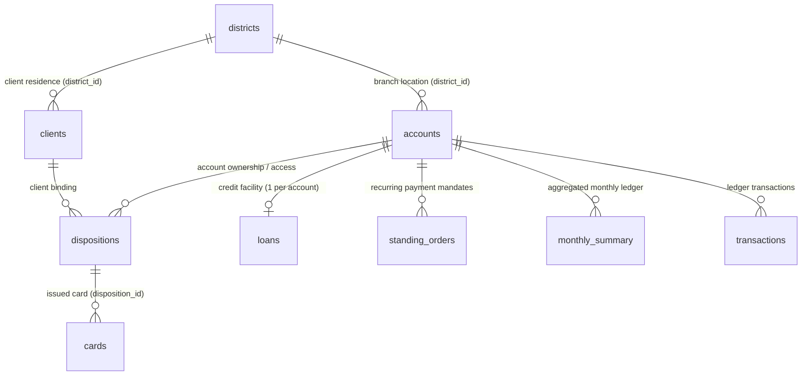
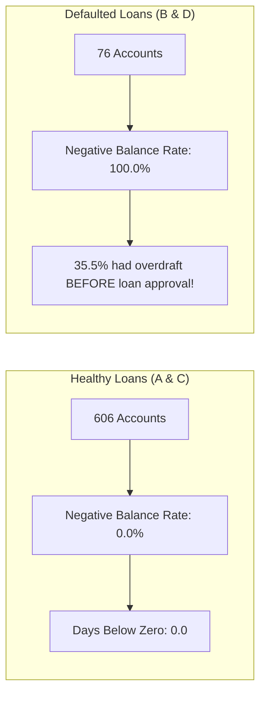
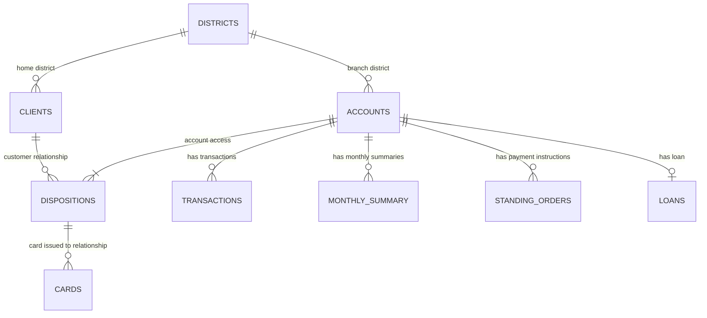

# Phase 1: Data Intelligence & Comprehensive System Audit
**Sheridan Datathon 2026 — Tangerine Track: Resilience Rewired**

---

## 1. Executive Summary & Data Inventory

The dataset represents an anonymized, modernized Canadian-dollar adaptation of longitudinal retail banking operations spanning **6 full calendar years** (January 1, 2020 through December 31, 2025). The relational ecosystem comprises **9 core tables**, totaling **1,254,089 records** across accounts, clients, cards, credit facilities, recurring orders, monthly financial rollups, and granular transaction ledgers.

| Table Name | File Size | Row Count | Column Count | Primary Key | Foreign Keys | Missing Values Summary |
| :--- | :--- | :--- | :--- | :--- | :--- | :--- |
| `accounts.csv` | 0.16 MB | 4,500 | 4 | `account_id` | `district_id` $\to$ `districts` | None (0%) |
| `clients.csv` | 0.12 MB | 5,369 | 4 | `client_id` | `district_id` $\to$ `districts` | None (0%) |
| `dispositions.csv` | 0.15 MB | 5,369 | 4 | `disposition_id` | `client_id` $\to$ `clients`, `account_id` $\to$ `accounts` | None (0%) |
| `cards.csv` | 0.03 MB | 892 | 4 | `card_id` | `disposition_id` $\to$ `dispositions` | None (0%) |
| `districts.csv` | 0.01 MB | 77 | 16 | `district_id` | N/A | `unemployment_rate_2022` (1), `crimes_2022` (1) |
| `loans.csv` | 0.05 MB | 682 | 9 | `loan_id` | `account_id` $\to$ `accounts` | None (0%) |
| `standing_orders.csv`| 0.27 MB | 6,471 | 6 | `order_id` | `account_id` $\to$ `accounts` | `purpose` (1,379 unlabelled, 21.3%) |
| `monthly_summary.csv`| 20.64 MB | 185,326 | 19 | (`account_id`, `month`) | `account_id` $\to$ `accounts` | None (0%) |
| `transactions.csv` | 97.87 MB | 1,056,320 | 11 | `transaction_id` | `account_id` $\to$ `accounts` | `purpose` (535,314), `partner_bank` (782,812), `partner_account` (760,931) |

---

## 2. Entity-Relationship & Structural Topology



### Relational Topology Key Invariants:
1. **Dispositions & Ownership Model:**
   - Exactly 4,500 rows have `type == 'owner'` (100% of accounts have exactly one primary owner).
   - Exactly 869 accounts have a secondary `authorized user` (`type == 'authorized user'`).
   - Demographics reveal that all 869 pairs represent heterosexual couples of near-identical age ($\Delta\text{Age} = -0.11 \pm 4.68$ years; 437 Male Owner / Female User, 432 Female Owner / Male User).
2. **Card Issuance Architecture:**
   - All 892 cards are attached strictly to the primary account `owner`. Zero cards are issued to secondary authorized users.
   - Breakdown: 659 `classic` (73.9%), 145 `junior` (16.3%), 88 `gold` (9.9%).
3. **District Divergence:**
   - 9.2% of bank clients ($N = 494$) reside in a district different from their account branch district, reflecting regional commuting or migration.
4. **Loans Constraint:**
   - Exactly 682 loans for 682 accounts (strictly $\le 1$ loan per account).

---

## 3. Temporal Coverage & Account Longevity

- **Total Horizon:** 72 calendar months (2020-01 through 2025-12).
- **Account Openings:** 2020-01-01 to 2024-12-29.
- **Account Longevity Distribution:**
  - Minimum: 12 months.
  - 25th Percentile: 26 months.
  - Median: 36 months.
  - Mean: 41.2 months.
  - Maximum: 72 months.
- **Buffer Feasibility Proof:** Because the minimum account tenure in the dataset is 12 months, **100% of the 4,500 accounts have at least 6 months of monthly summary history**, ensuring that the 6-month average daily balance buffer ($B$) is computable without truncation for any account chosen by judges.

---

## 4. Mathematical & Accounting Integrity Validation

We executed programmatic accounting balance reconciliations across the 185,326 monthly summary records and 1,056,320 transaction records:

### A. Additive Inflow Decomposition
$$\text{money\_in} = \text{cash\_deposits} + \text{transfers\_in} + \text{pension\_in} + \text{interest\_in}$$
- Maximum absolute discrepancy observed across all 185,326 rows: **$2.91 \times 10^{-11}$ CAD** (zero deviation beyond IEEE 754 float precision).

### B. Additive Outflow Decomposition
$$\text{money\_out} = \text{household\_bills} + \text{insurance} + \text{loan\_payments} + \text{bank\_fees} + \text{cash\_withdrawals\_genuine} + \text{card\_withdrawals} + \text{transfers\_out\_other}$$
- Maximum absolute discrepancy observed across all 185,326 rows: **$2.91 \times 10^{-11}$ CAD** (zero deviation).

### C. Transaction-to-Monthly Summary Cross-Validation
- Programmatic aggregation of raw `transactions.csv` credits and debits against `monthly_summary.csv` showed exact correspondence ($0.0000$ difference) across accounts.
- `loan_payments` in `monthly_summary.csv` are strictly non-zero only for the exact 682 accounts present in `loans.csv`.

### D. Inter-Month Balance Roll-Forward
$$\text{month\_end\_balance}_{t} = \text{month\_end\_balance}_{t-1} + \text{money\_in}_t - \text{money\_out}_t$$
- Across 180,826 consecutive month transitions, the maximum discrepancy was $\$0.14$, with minor cent-level rounding differences attributable to daily interest capitalization and fee timing at midnight.

---

## 5. Verification of Critical Judging Metrics & Twist Formulas

We audited the exact metrics mandated by the Tangerine challenge specification across all 4,500 accounts:

### Judging Metric Definitions & Distribution:

| Metric | Official Definition | Dataset Distribution (Mean) | Dataset Distribution (Median) | Edge Case Considerations |
| :--- | :--- | :--- | :--- | :--- |
| **Typical Money In ($I$)** | `median(money_in)` | $\$9,329.32$ | $\$7,568.26$ | Min: $\$0.00$ (dormant accounts) |
| **Typical Fixed Costs ($F$)** | `median(household_bills + insurance + loan_payments)` | $\$2,219.53$ | $\$1,774.17$ | Computed row-wise sum per month, then median |
| **Typical Monthly Spending ($S$)** | `median(money_out)` | $\$7,867.14$ | $\$6,380.20$ | Includes discretionary & non-discretionary |
| **Savings Buffer ($B$)** | `mean(avg_daily_balance)` over last 6 months | $\$25,083.12$ | $\$22,325.10$ | 23 accounts have $B \le 0$ (min: $-\$17,267.08$) |
| **Household Bills ($H$)** | `median(household_bills)` | $\$1,498.80$ | $\$1,240.50$ | Baseline for utility/rent escalation shocks |
| **Active Loan Payment ($P$)** | `monthly_payment` in `loans.csv` if running at end of 2025, else 0 | $\$255.22$ across all; $\$2,562.90$ for active | $\$0.00$ overall; $\$2,330.19$ for active | Exactly 448 loans running at end of 2025 |

### Active Loan Verification at End of 2025:
- **Status A (Finished, repaid):** 203 loans. Expiration dates range from 2021-09-15 to 2025-12-28. None are running at end of 2025.
- **Status B (Finished, defaulted):** 31 loans. Expiration dates range from 2021-07-05 to 2025-12-01. None are running at end of 2025.
- **Status C (Running, OK so far):** 403 loans. Expiration dates range from 2026-01-04 to 2030-12-08. **100% active at end of 2025**.
- **Status D (Running, client in debt):** 45 loans. Expiration dates range from 2026-01-03 to 2030-10-14. **100% active at end of 2025**.
- **Conclusion:** A loan is running at the end of 2025 if and only if `status in ['C', 'D']` ($N = 448$).

### Baseline Runway Distribution (No Shock):
$$\text{buffer\_left} = B - 0, \quad \text{gap} = S - I$$
- $\text{gap} \le 0$ (Surplus Cash Flow): **3,540 accounts (78.7%)** $\to$ Runway is capped at **"120+ (no shortfall)"**.
- $\text{gap} > 0$ and $B > 0$ (Deficit Cash Flow): **936 accounts (20.8%)** $\to$ Median runway = **28.4 months**.
- $B \le 0$ (Negative Buffer): **23 accounts (0.51%)** $\to$ Runway = **0.0 months**.

---

## 6. Critical Preliminary Risk Revelations

During our deep data reconnaissance, we uncovered foundational behavioral anomalies:



1. **The Overdraft Determinism Anomaly:**
   - **0 out of 606 (0.0%)** borrowers with healthy loans (Status A and C) ever experienced a negative balance or overdraft.
   - **76 out of 76 (100.0%)** borrowers who defaulted or fell into distressed debt (Status B and D) experienced negative balances.
   - Overdraft history is a deterministic indicator of default in this portfolio.
2. **The Underwriting Blindspot Anomaly:**
   - Of the 76 defaulted loans, **27 borrowers (35.5%)** experienced negative balance events **prior to the loan origination date** (8 in Status B, 19 in Status D).
   - The bank granted loans to customers with active, recorded overdraft distress on their own accounts.
3. **The Silent Deficit Population:**
   - 1,181 accounts (26.2%) run a monthly deficit ($S > I$) at baseline, surviving by steadily eroding accumulated savings buffers, long before entering negative balances.
4. **District 69 Data Caveat:**
   - District 69 (Jesenik, north Moravia) has missing values for `unemployment_rate_2022` and `crimes_2022`. Any regional modeling must handle imputation (e.g., using regional median or 2023 back-projection).

---

## 7. Analytical Opportunities & Vectors for Phase 2 Discovery

| Research Vector | Analytical Hypothesis / Question | Datasets Leveraged |
| :--- | :--- | :--- |
| **Payday-to-Payday Elasticity** | Are customers with high average salaries running dangerous intra-month balance swings? | `transactions`, `monthly_summary`, `districts` |
| **Pre-Default Lead Time Engine** | How many months before loan default does cash-flow volatility decouple from balance? | `loans`, `monthly_summary`, `transactions` |
| **Discretionary Shock Cushion** | What percentage of $S$ is truly compressible (genuine cash/card withdrawals vs fixed bills)? | `monthly_summary`, `standing_orders` |
| **Regional Vulnerability Gradient** | Does a regional unemployment spike (2022 $\to$ 2023) predict individual balance deterioration? | `districts`, `monthly_summary`, `accounts` |
| **Overdraft Penalty Cascade** | Do bank penalty fees accelerate balance decay in distressed customers? | `transactions`, `monthly_summary` |

---

# Appendix A — Team Learning Guide: Understanding Every Table, Field and Relationship

This appendix is a plain-language guide for teammates who are new to the dataset. It explains what one row means in each file, what every column represents, how the files connect, and what to avoid when joining or analysing them.

**Use this section to understand the schema before building dashboards, statistical analyses or machine-learning models.** The official challenge README is the authority for challenge-specific definitions and judging calculations. Where this appendix describes analytical opportunities, those are suggestions—not findings that the data has already proved.

## A1. The dataset in one sentence

This is a relational banking dataset: customer and account records are connected to transaction events, monthly financial summaries, loans, recurring payment instructions, cards and district-level context.

The nine files do not all describe the same kind of thing. Each has its own **grain**—the meaning of one row.

| File | What one row represents | Main key |
|---|---|---|
| `clients.csv` | One customer | `client_id` |
| `accounts.csv` | One bank account | `account_id` |
| `dispositions.csv` | One customer's relationship with an account | `disposition_id` |
| `cards.csv` | One issued card | `card_id` |
| `districts.csv` | One district | `district_id` |
| `transactions.csv` | One individual transaction | `transaction_id` |
| `monthly_summary.csv` | One account in one month | (`account_id`, `month`) |
| `loans.csv` | One loan | `loan_id` |
| `standing_orders.csv` | One standing-order instruction | `order_id` |

A **primary key (PK)** uniquely identifies a row in its table. A **foreign key (FK)** points to a key in another table and creates a relationship.

## A2. How the nine tables connect



The central financial entity is `accounts.csv`: most financial activity is connected using `account_id`.

There are three relationship ideas to remember:

1. **Customer ↔ Account:** `dispositions.csv` is the bridge. It tells us which customer is the owner or an authorized user of an account.
2. **Account → Financial activity:** Transactions, monthly summaries, loans and standing orders use `account_id`.
3. **District → Customer or Account:** `clients.district_id` is the customer's home district, while `accounts.district_id` is the account's branch district. They are different meanings even though the column has the same name.

### Observed relationship facts in the Phase 1 audit

- There are 4,500 accounts and exactly 4,500 owner dispositions: every account has one primary owner.
- There are 869 additional `authorized user` dispositions.
- There are 682 loans for 682 accounts; no account has more than one loan in this dataset.
- There are 892 cards, and the Phase 1 audit reports they are attached to primary-owner dispositions.
- The account-to-transaction and account-to-monthly-summary relationships are one-to-many.
- Standing orders are one-to-many from an account.

**Interpretation warning:** `authorized user` means permission to use an account. It does not, by itself, prove that the person is a spouse, partner, relative or member of the same household. Do not infer a personal relationship from gender or age similarity.

---

## A3. File-by-file data dictionary

### 1. `accounts.csv` — Bank accounts

**4,500 rows · One row per account**

This table describes the bank accounts. It is the main starting point for account-level analysis.

| Field | Key / type | Meaning |
|---|---|---|
| `account_id` | PK | Unique identifier for a bank account. This is the main key used to connect financial activity to an account. |
| `district_id` | FK → `districts.district_id` | District where the account's bank branch is located. This is a branch location, not necessarily the customer's home district. |
| `frequency` | Category | How often the account receives statements. It is not transaction frequency. |
| `account_opened` | Date | Date the account was opened. Can be used to calculate account tenure at a chosen analysis date. |

**Questions this table may help investigate**

- Does account tenure relate to buffer size or resilience?
- Do account outcomes differ by branch district?
- Does statement frequency relate to observed account behaviour?

### 2. `clients.csv` — Customers

**5,369 rows · One row per customer**

This table stores basic client information.

| Field | Key / type | Meaning |
|---|---|---|
| `client_id` | PK | Unique identifier for a customer. |
| `gender` | Category | Gender value recorded in the source data. |
| `birth_date` | Date | Customer's date of birth. |
| `district_id` | FK → `districts.district_id` | Customer's home/residential district. |

**Questions this table may help investigate**

- Do age bands show different financial patterns?
- How does financial buffer vary across customer groups?
- Do home-district conditions relate to account-level outcomes?

**Careful:** Calculate age relative to an explicit observation date, such as 2025-12-31, rather than treating it as the customer's current age. Demographic differences are descriptive and do not establish why an individual behaves financially in a certain way.

### 3. `dispositions.csv` — Customer-to-account relationships

**5,369 rows · One row per customer-account relationship**

This is the bridge between `clients.csv` and `accounts.csv`. It is essential for finding the customer associated with an account.

| Field | Key / type | Meaning |
|---|---|---|
| `disposition_id` | PK | Unique identifier for this customer-account relationship. |
| `client_id` | FK → `clients.client_id` | Customer involved in the relationship. |
| `account_id` | FK → `accounts.account_id` | Account involved in the relationship. |
| `type` | Category | Relationship type: `owner` or `authorized user`. |

Observed types:

| `type` | Meaning | Rows reported in Phase 1 audit |
|---|---|---:|
| `owner` | Primary owner of the account | 4,500 |
| `authorized user` | A person authorized to use the account | 869 |

**Why it matters:** An account may have an owner and an authorized user. For the challenge's primary account-holder profile, use the `owner` disposition unless the analysis explicitly concerns authorized users.

**Join warning:** Joining all dispositions to account-level transactions can duplicate transaction values for accounts with more than one disposition. Filter to owners when building one primary customer profile per account.

### 4. `cards.csv` — Issued cards

**892 rows · One row per card**

Cards connect to a customer-account relationship through `disposition_id`, not directly to `account_id`.

| Field | Key / type | Meaning |
|---|---|---|
| `card_id` | PK | Unique card identifier. |
| `disposition_id` | FK → `dispositions.disposition_id` | Customer-account relationship to which the card is attached. |
| `card_type` | Category | Card category recorded in the data: `junior`, `classic` or `gold`. |
| `issued` | Date | Date the card was issued. |

Phase 1 audit counts:

| Card type | Count |
|---|---:|
| `classic` | 659 |
| `junior` | 145 |
| `gold` | 88 |
| **Total** | **892** |

**Interpretation warning:** The dictionary does not establish whether these are credit cards or debit cards, nor does it define their product features. Do not infer benefits, credit limits or spending capacity from the card label alone.

**Possible analysis:** Explore whether card category or card issuance timing is associated with different account segments. Treat this as descriptive, not causal.

### 5. `districts.csv` — District-level geographic and economic context

**77 rows · One row per district**

This table adds contextual information about the districts associated with customers and account branches.

| Field | Meaning |
|---|---|
| `district_id` | PK; unique district identifier. |
| `district_name` | District name. |
| `region` | Region containing the district. |
| `inhabitants` | Number of inhabitants in the district. |
| `municipalities_under_500` | Number of municipalities with fewer than 500 inhabitants. |
| `municipalities_500_1999` | Number of municipalities with 500–1,999 inhabitants. |
| `municipalities_2000_9999` | Number of municipalities with 2,000–9,999 inhabitants. |
| `municipalities_over_10000` | Number of municipalities with more than 10,000 inhabitants. |
| `num_cities` | Number of cities in the district. |
| `urban_ratio_pct` | Urbanization ratio, expressed as a percentage. |
| `average_salary` | Average monthly salary measure for the district. The challenge README says money columns are CAD; confirm original units and geographic comparability before making external comparisons. |
| `unemployment_rate_2022` | District unemployment-rate measure for 2022. |
| `unemployment_rate_2023` | District unemployment-rate measure for 2023. |
| `entrepreneurs_per_1000` | Entrepreneurs per 1,000 inhabitants. |
| `crimes_2022` | District crime measure for 2022. |
| `crimes_2023` | District crime measure for 2023. |

**Two district fields have different meanings depending on the table:**

- `accounts.district_id` = account branch district.
- `clients.district_id` = customer home district.

Keep both, and rename them to `branch_district_id` and `home_district_id` when joining.

**Context warning:** District indicators describe a population or area, not an individual customer. A high district unemployment rate does not prove that a specific customer is unemployed. Phase 1 audit notes that district 69 is missing `unemployment_rate_2022` and `crimes_2022`; regional models need an explicit missing-data strategy.

### 6. `transactions.csv` — Individual financial transactions

**1,056,320 rows · One row per transaction · 2020-01-01 to 2025-12-31**

This is the detailed transaction ledger. Each row is one movement of money associated with an account.

| Field | Key / type | Meaning |
|---|---|---|
| `transaction_id` | PK | Unique transaction identifier. |
| `account_id` | FK → `accounts.account_id` | Account involved in the transaction. |
| `date` | Date | Date of the transaction. |
| `direction` | Category | `credit (money in)` or `debit (money out)`. |
| `operation` | Category | Transaction mechanism/type, such as cash deposit, cash withdrawal, card withdrawal, transfer in, transfer out, bill payment, bank fee or interest. |
| `purpose` | Category / may be blank | Known reason or accounting category, such as household bills, insurance, loan payment, pension, interest credited, statement fee or penalty interest. Blank means not labelled. |
| `amount` | Numeric, positive | Transaction amount. The value is always positive, regardless of direction. |
| `signed_amount` | Numeric, signed | Positive for money in and negative for money out. Useful for net-flow calculations. |
| `balance` | Numeric | Account balance after the transaction. |
| `partner_bank` | Text / may be blank or 0 | Other bank's two-letter code for transfers. Read it as text. |
| `partner_account` | Text / may be blank or 0 | Account number at the other bank for transfers. It is not the dataset's internal `account_id`. |

#### `direction`, `operation` and `purpose` are not interchangeable

- `direction` answers: Did money enter or leave?
- `operation` answers: What type of transaction occurred?
- `purpose` answers: What was the known reason/category?

For example, a `bill payment` is an operation; `household bills` can be its purpose; its direction is normally a debit.

#### `amount` versus `signed_amount`

Illustrative example:

| Event | `amount` | `signed_amount` |
|---|---:|---:|
| Deposit received | 1,000 | +1,000 |
| Bill paid | 200 | -200 |

Net flow = +1,000 − 200 = +800.

#### Transaction cautions

- The README says rows within the same day are not in time order. Sorting on `date` does not reconstruct a reliable intraday sequence.
- `partner_account` is an external-bank account number, not an internal account key.
- `purpose` is not always known. Do not automatically assign a purpose to blank values.
- The Phase 1 audit reports 535,314 blank `purpose` values, plus large numbers of blank transfer partner fields. These blanks are expected in the source and do not all indicate bad data.

**Possible analyses:** transaction frequency, deposit/withdrawal behaviour, transfer activity, changes in transaction mix, penalty fees, and transaction-level explanations of monthly patterns.

### 7. `monthly_summary.csv` — Monthly account-level financial summary

**185,326 rows · One row per account per month**

This is the most important table for the required customer baseline and shock simulation. It is built from transactions and includes quiet months; balances are carried forward on days without activity.

The composite key is:

`account_id + month`

| Field | Meaning |
|---|---|
| `account_id` | Account being summarized; FK → `accounts.account_id`. |
| `month` | Month in `YYYY-MM` format. |
| `money_in` | Total money entering the account in the month. |
| `money_out` | Total money leaving the account in the month. |
| `cash_deposits` | Money entering through cash deposits. |
| `transfers_in` | Incoming transfers; excludes pensions. |
| `pension_in` | Pension money received. |
| `interest_in` | Interest credited. |
| `household_bills` | Household bills paid. |
| `insurance` | Insurance payments. |
| `loan_payments` | Loan payments. |
| `bank_fees` | Bank fees, including statement fees and penalty interest as defined in the README. |
| `cash_withdrawals_genuine` | Cash withdrawals. |
| `card_withdrawals` | Card withdrawals. |
| `transfers_out_other` | Unlabelled transfers out. |
| `month_end_balance` | Balance at the end of the final day of the month. |
| `min_balance` | Lowest end-of-day balance in the month. |
| `avg_daily_balance` | Average end-of-day balance during the month. |
| `days_below_zero` | Number of days that ended with a negative balance. |

#### How the monthly money fields relate

Money coming in:

```text
money_in =
    cash_deposits
  + transfers_in
  + pension_in
  + interest_in
```

Money going out:

```text
money_out =
    household_bills
  + insurance
  + loan_payments
  + bank_fees
  + cash_withdrawals_genuine
  + card_withdrawals
  + transfers_out_other
```

The Phase 1 audit reports that these decompositions reconcile to floating-point precision across all 185,326 rows.

#### The balance fields measure different things

- `month_end_balance`: where the account finished the month.
- `min_balance`: its lowest end-of-day point during the month.
- `avg_daily_balance`: average end-of-day balance through the month.
- `days_below_zero`: number of days ending with a negative balance.

Do not treat these as interchangeable. An account can finish a month with a positive balance after having had a low balance or several negative-balance days.

**Why this table matters for Resilience Rewired:** the judge's customer baseline is calculated from monthly rows. The challenge defines typical income, typical spending, fixed costs, household bills and the six-row average balance buffer using this file.

### 8. `loans.csv` — Loan information and outcomes

**682 rows · One row per loan · At most one loan per account**

| Field | Key / type | Meaning |
|---|---|---|
| `loan_id` | PK | Unique loan identifier. |
| `account_id` | FK → `accounts.account_id` | Account associated with the loan. |
| `loan_start` | Date | Date the loan was granted. |
| `amount` | Numeric | Loan amount field. The challenge README defines `amount = duration_months × monthly_payment`; do not assume this is an outstanding balance. |
| `duration_months` | Numeric | Loan length in months. |
| `monthly_payment` | Numeric | Scheduled monthly loan payment. |
| `status` | Category | Short status code: A, B, C or D. |
| `status_meaning` | Text | Description of the status. |
| `defaulted` | Binary | 1 for status B or D; 0 for A or C. |

Status meanings:

| Status | Meaning | `defaulted` |
|---|---|---:|
| A | Finished, repaid | 0 |
| B | Finished, NOT repaid | 1 |
| C | Running, OK so far | 0 |
| D | Running, client in debt | 1 |

At the end of 2025, the Phase 1 audit identifies 448 running loans: statuses C and D.

**Important analytical caveat:** Status C is still running and OK so far; it is not a completed repayment. Status D is also running but the client is in debt. Treating every 0 in `defaulted` as a fully completed successful loan would be incorrect.

**Possible analyses:** compare pre-loan buffers and cash-flow stability with later loan status; investigate whether negative-balance days or high volatility are associated with distress. These are associations unless a suitable causal design is established.

### 9. `standing_orders.csv` — Recurring payment instructions

**6,471 rows · One row per standing-order instruction**

| Field | Key / type | Meaning |
|---|---|---|
| `order_id` | PK | Unique standing-order identifier. |
| `account_id` | FK → `accounts.account_id` | Account issuing the instruction. |
| `to_bank` | Text | Destination bank code. |
| `to_account` | Text | Destination bank account number. Not the internal `account_id`. |
| `amount` | Numeric | Amount specified in the instruction. |
| `purpose` | Category / may be blank | Known instruction purpose, such as household bills, insurance, leasing or loan payment. Blank means other/unlabelled. |

**Critical limitation:** The README describes this as an undated end-of-data snapshot. It does not provide an effective date or frequency. Do not assume that every standing order was monthly or active throughout the full transaction history.

**Join warning:** The same payment may also appear in actual transactions and monthly spending. Do not add standing-order amounts to `money_out`; that risks double-counting. Use standing orders as context about scheduled commitments.

---

## A4. The two financial tables: transactions versus monthly summary

These tables describe the same underlying financial activity at different levels of detail.

| `transactions.csv` | `monthly_summary.csv` |
|---|---|
| One row per individual event | One row per account per month |
| Records transaction date, operation and amount | Records monthly totals and balance statistics |
| Useful for detailed behaviour | Useful for trends, baselines and resilience calculations |
| More than one million rows | About 185 thousand rows |

Illustrative example:

**Individual transaction rows**

| Date | Operation | Direction | Amount |
|---|---|---|---:|
| Example day 1 | Cash deposit | Credit | $1,000 |
| Example day 7 | Bill payment | Debit | $300 |
| Example day 12 | Cash withdrawal | Debit | $100 |
| Example day 20 | Transfer in | Credit | $500 |
| Example day 25 | Insurance | Debit | $100 |

A monthly summary aggregates the relevant events into monthly inflow, outflow and balance measures.

**Never add totals from both files together.** The monthly summary is derived from the transaction ledger. Doing so would double-count the same financial activity.

Use `transactions.csv` when the question is "What kinds of events happened?" Use `monthly_summary.csv` when the question is "How did the account perform over the month?"

---

## A5. Correct join strategy

### Build a primary account-owner profile

The following example creates one row per account, adds the primary owner, and keeps branch and home district identifiers separate.

```python
import pandas as pd

accounts = pd.read_csv("accounts.csv")
clients = pd.read_csv("clients.csv")
dispositions = pd.read_csv("dispositions.csv")
districts = pd.read_csv("districts.csv")

# Keep the two district meanings separate.
accounts = accounts.rename(
    columns={"district_id": "branch_district_id"}
)
clients = clients.rename(
    columns={"district_id": "home_district_id"}
)

# One primary owner relationship per account.
owners = dispositions.loc[
    dispositions["type"].eq("owner"),
    ["account_id", "client_id"]
]

# Account + owner + client profile.
profiles = (
    accounts
    .merge(
        owners,
        on="account_id",
        how="left",
        validate="one_to_one"
    )
    .merge(
        clients,
        on="client_id",
        how="left",
        validate="one_to_one"
    )
)

# Add branch district context.
branch_districts = districts.add_prefix("branch_")
profiles = profiles.merge(
    branch_districts,
    left_on="branch_district_id",
    right_on="branch_district_district_id",
    how="left",
    validate="many_to_one"
)

# Add customer's home district context.
home_districts = districts.add_prefix("home_")
profiles = profiles.merge(
    home_districts,
    left_on="home_district_id",
    right_on="home_district_district_id",
    how="left",
    validate="many_to_one"
)

assert len(profiles) == 4500
print(profiles.head())
```

`validate=` asks pandas to check the expected join relationship. It helps catch accidental row multiplication.

### Aggregate child tables before combining them

Transactions, monthly summaries and standing orders can each contain many rows per account. Do not join all their raw rows together.

A safer pattern is:

1. Choose the target grain (for example, one row per account).
2. Aggregate transactions to one row per account or account-month.
3. Aggregate standing orders to one row per account if a summary is required.
4. Keep monthly summaries at account-month grain for time-series work.
5. Join the already-aggregated outputs to the account profile.

### Common join mistakes

| Mistake | Why it is wrong | Safer approach |
|---|---|---|
| Joining all dispositions to transactions | Authorized users can duplicate account activity | Filter to owners for primary customer profiles |
| Treating account district and home district as one field | They describe different locations | Rename and retain both |
| Joining raw transactions, monthly summaries and standing orders together | Multiple child tables multiply rows | Aggregate each table first |
| Joining `partner_account` to `accounts.account_id` | External account number is not the internal key | Keep external transfer details separate |
| Adding standing-order amounts to spending | Instructions may already be represented in actual transactions | Use as context; don't add to actual outflows |
| Adding transaction totals and monthly totals | Both represent the same underlying activity | Use one grain for each calculation |

---

## A6. How the schema supports the Tangerine challenge

The required customer-level metrics come primarily from `monthly_summary.csv`, with loan context from `loans.csv`.

| Challenge output | Source | Definition |
|---|---|---|
| Typical monthly money in (`I`) | `monthly_summary.csv` | Median `money_in` for the account |
| Typical fixed costs (`F`) | `monthly_summary.csv` | Median of the row-wise sum `household_bills + insurance + loan_payments` |
| Typical monthly spending (`S`) | `monthly_summary.csv` | Median `money_out` for the account |
| Buffer (`B`) | `monthly_summary.csv` | Mean `avg_daily_balance` over the account's last six monthly rows, sorted by month |
| Household bills (`H`) | `monthly_summary.csv` | Median `household_bills` |
| Active loan payment (`P`) | `loans.csv` | `monthly_payment` if the loan is still running at the end of 2025; otherwise 0 |

### Runway formula from the challenge README

```text
buffer_left = B - one_off_costs
gap = spending_after_shock - income_after_shock

if buffer_left <= 0:
    runway = 0
elif gap <= 0:
    runway = "no shortfall (120+)"
else:
    runway = min(buffer_left / gap, 120)
```

Runway is rounded to one decimal place.

Examples of shock transformations:

- Job loss with EI at 55%: `income_after_shock = 0.55 * I`
- Household bills increase by 15%: `spending_after_shock = S + 0.15 * H`
- One-off repair: subtract the repair cost from the buffer before calculating runway.

**Do not double-count loan payments:** `loan_payments` are already a component of `money_out`. The fixed-cost metric F is shown in the customer profile, but the challenge README says it is not independently added to the runway formula. P is loan context and should not be added a second time to spending.

---

## A7. Which file should we use for which question?

| Research question | Primary file | Supporting files |
|---|---|---|
| What is a customer's financial baseline? | `monthly_summary.csv` | `accounts.csv`, `clients.csv`, `dispositions.csv` |
| How stable is money coming in? | `monthly_summary.csv` | `transactions.csv` |
| What types of transactions happen? | `transactions.csv` | `monthly_summary.csv` |
| How does the balance change over time? | `monthly_summary.csv` | `transactions.csv` |
| Which accounts have loans and what is their status? | `loans.csv` | `monthly_summary.csv` |
| What happened before loan origination? | `monthly_summary.csv` | `loans.csv`, `transactions.csv` |
| What recurring instructions exist? | `standing_orders.csv` | `transactions.csv`, `monthly_summary.csv` |
| Who is the primary account owner? | `dispositions.csv` | `clients.csv`, `accounts.csv` |
| What card category is recorded? | `cards.csv` | `dispositions.csv` |
| How do home and branch districts differ? | `clients.csv`, `accounts.csv` | `dispositions.csv`, `districts.csv` |
| Are account outcomes different by district context? | `monthly_summary.csv` | `accounts.csv`, `clients.csv`, `districts.csv` |

---

## A8. Suggested learning order for teammates

1. **Understand IDs and relationships:** `accounts`, `clients`, `dispositions`, `districts`.
2. **Understand financial events:** `transactions`.
3. **Understand monthly performance:** `monthly_summary`.
4. **Understand financial commitments and outcomes:** `loans`, `standing_orders`.
5. **Understand card relationships:** `cards`.
6. **Build a one-account profile:** trace an account through its owner, district, monthly history, transactions, loan and standing orders.
7. **Only then begin hypothesis testing and modelling.**

### Team knowledge check

1. Which table connects a client to an account?  
   **Answer:** `dispositions.csv`.

2. Which field gives the average end-of-day balance for a month?  
   **Answer:** `avg_daily_balance`.

3. What uniquely identifies a monthly summary row?  
   **Answer:** The combination of `account_id` and `month`.

4. Which district field describes the customer's home district?  
   **Answer:** `clients.district_id`.

5. Can we add `transactions.csv` totals to `monthly_summary.csv` totals?  
   **Answer:** No. The monthly summary is built from transactions.

6. Does `standing_orders.csv` tell us that every order is monthly?  
   **Answer:** No. It is an undated end-of-data snapshot and has no frequency field.

7. Does `partner_account` refer to our internal `account_id`?  
   **Answer:** No. It is an account number at another bank.

8. Does loan status C mean the loan has been fully repaid?  
   **Answer:** No. It means the loan is still running and OK so far.

---

## A9. Source and interpretation notes

- Field definitions and the official challenge formulas in this guide are based on the supplied Sheridan Datathon `README.md`.
- Observed table counts and relationship checks are taken from the Phase 1 audit above.
- The supplied dataset is credited by the challenge README to the **PKDD'99 Discovery Challenge Financial dataset**, from the CTU Prague Relational Dataset Repository: https://relational.fel.cvut.cz/dataset/Financial
- Any example values in this learning guide are illustrative unless explicitly identified as an observed count or result.
- Suggested business questions are analysis opportunities, not established findings.
- Do not infer that an individual customer is employed, unemployed, married, financially irresponsible or otherwise characterized beyond what the supplied fields directly establish.
