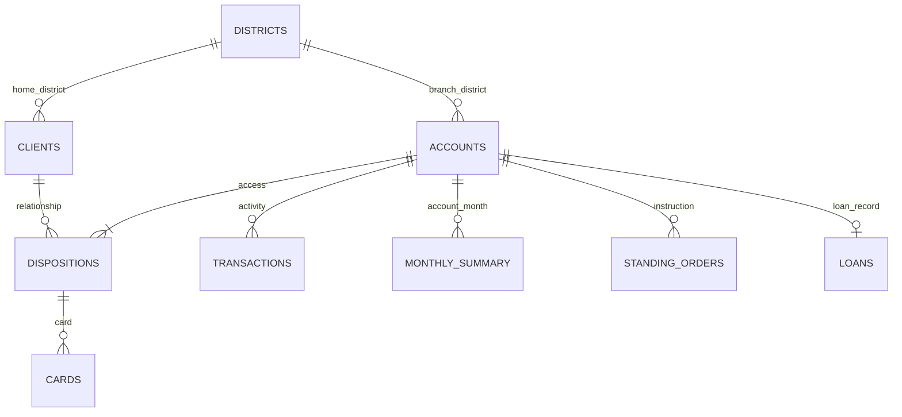

# Phase 1 — Data Intelligence Audit (Corrected)

**Project:** Resilience Rewired · Sheridan Datathon 2026
**Status:** Reconciled with the current source CSVs and application calculations. Prior unsupported discovery interpretations are superseded by `phase2_hidden_patterns_discovery.md`.

## 1. Dataset inventory

The application expects these nine CSVs in `tangerine/data`. Current row counts are verified by `tests/test_discovery_reproduction.py` and `python src/discovery/run_discoveries.py`.

| File | Rows | Grain / primary use |
|---|---:|---|
| `accounts.csv` | 4,500 | Account directory, branch and statement frequency |
| `clients.csv` | 5,369 | Client attributes |
| `dispositions.csv` | 5,369 | Account access roles: owner or authorized user |
| `cards.csv` | 892 | Cards linked to disposition records |
| `districts.csv` | 77 | Area-level contextual attributes |
| `loans.csv` | 682 | Loan terms, status and supplied default flag |
| `standing_orders.csv` | 6,471 | Undated standing-order instructions |
| `monthly_summary.csv` | 185,326 | Account-month financial and balance statistics |
| `transactions.csv` | 1,056,320 | Individual transaction records |

Financial and transaction observations span 2020–2025. Account histories are variable; portfolio and account windows are not necessarily six complete calendar years.

## 2. Relationships and safe joins



- `dispositions.csv` is the client-account bridge. Use `type == 'owner'` for the primary account profile.
- `authorized user` means permission to use an account. It does not establish a spouse, partner, family member, household member or co-borrower.
- `accounts.district_id` is the account branch district; `clients.district_id` is the client's home district. Keep them distinct after joins.
- Aggregate account-month or transaction data before joining multiple one-to-many tables. Otherwise account data can be multiplied.
- `partner_account` / `to_account` are destination identifiers, not internal `account_id` values.
- A standing-order row is a payment instruction; it has no effective date or frequency. Do not treat its amount as monthly or add it to observed `money_out`.

## 3. Monthly-summary fields used by the product

`monthly_summary.csv` has one record per account-month. Its challenge-relevant fields include:

| Field | Product interpretation |
|---|---|
| `money_in` | Recorded monthly inflow; includes deposits, transfers, pensions and interest, not verified payroll |
| `money_out` | Recorded total outflow |
| `household_bills` | Observed bills component |
| `insurance`, `loan_payments` | Observed outflow components used in F |
| `avg_daily_balance` | Monthly mean balance measure used in the buffer |
| `days_below_zero` | Days ending below zero, not every possible intraday overdraft |
| `cash_deposits`, `cash_withdrawals_genuine` | Observed transaction categories; not proof of income source or discretionary spend |

The monthly summary and transaction ledger represent the same underlying activity at different grains. Do not add their totals together. Blank transaction purposes remain unclassified.

## 4. Challenge baseline definitions and corrected medians

For each account, monthly rows are sorted by `month` and then summarized:

| Measure | Definition |
|---|---|
| I | Median `money_in` |
| F | Median of row-wise `household_bills + insurance + loan_payments` |
| S | Median `money_out` |
| B | Mean `avg_daily_balance` over the latest six chronological rows |
| H | Median `household_bills` |
| P | `monthly_payment` for status C or D; otherwise zero |

The portfolio medians below are computed across account-level values for all 4,500 accounts. They must not be confused with medians over all monthly rows.

| Measure | Account-level portfolio median |
|---|---:|
| I | $7,568.26 |
| S | $7,388.65 |
| F | $1,774.16 |
| H | $1,536.68 |
| B | $22,325.10 |
| Accounts where S > I | 1,181 / 4,500 |
| Accounts with B <= 0 | 23 / 4,500 |

The account-level table produced by `compute_portfolio_account_metrics` is the shared source for the account service, portfolio summary, scenario distribution and income-decile discovery. Portfolio outputs and account displays use the same one-decimal Judge Match calculation.

## 5. Runway and rounding

```text
buffer_left = B - one_off_costs
monthly_gap = spending_after_shock - income_after_shock
if buffer_left <= 0: runway = 0
elif monthly_gap <= 0: runway = 120+ (no shortfall)
else: runway = round(min(buffer_left / monthly_gap, 120), 1)
```

The official one-decimal result is calculated before strict threshold counts. An account displayed as 6.0 months is not counted as below six months. The previous mixed use of unrounded values and rounded displays is removed.

## 6. Loan outcomes and pre-loan records

The supplied loan table contains 682 loans. Status A is completed and repaid; B is completed and not repaid; C is running and currently OK; D is running and in debt. The supplied `defaulted` flag is 1 for B and D. A non-defaulted running loan is not a completed successful loan.

The pre-loan analysis requires six available monthly records before `loan_start` and uses the latest six. It reports loan counts and default counts by buffer quartile and separately by any negative-balance days. The group comparisons are observational and unadjusted. The six rows are not asserted to be consecutive calendar months.

## 7. Corrected interpretation of prior hypotheses

| Earlier label / statement | Current handling |
|---|---|
| Spousal Shield | Authorized-user account association only; no relationship inference |
| Statement Canary | Negative-balance association and loan outcomes shown separately |
| Inverted Resilience | Simulated 55% money-in scenario only |
| Cardholder Immunity | Descriptive association; no causal or protective effect |
| Cash Addiction | Renamed Cash Deposit Reliance; no income-quality inference |
| Leasing Overextension | Leasing-labelled standing-order evidence; no confirmed monthly contract |
| External Debt Shadow | External-destination payment instructions; not confirmed external debt |
| Penalty Fee Death Spiral | Causal/temporal claim removed without sequencing evidence |
| Payday Evaporation | 48–72-hour claim removed; no supported account-level sequence analysis |
| 76% Spend Cushion | Cash withdrawals are not classified as discretionary |

## 8. Data and product limitations

- The 55% scenario acts on recorded money-in, not confirmed employment income or EI receipt.
- The emergency-fund planner displays recent six-row median net cash flow; it does not use a historical savings estimate as a forecast.
- When F is zero, an essential-cost estimate must be entered by the user; no expense fallback is invented.
- The gap optimizer is deterministic and accepts a selected survival duration and monthly adjustment. Its optional modeled adjustment is separate from Judge Match Runway.
- Lender and lease adjustments are options to investigate, not guaranteed programs, approvals or savings.
- Snowflake is not queried by the app. SQL scripts are optional setup examples. Gemini, if configured, provides optional explanation only.
- Local CSVs remain the operational source of truth; all nine file presences and expected row counts are checked by tests.

## 9. Reproduction

```powershell
python -m compileall -q app.py config src tests
python -m pytest
python src/discovery/run_discoveries.py
```

The automated discovery reproduction test independently calculates account medians, baseline coverage, one-decimal scenario thresholds, dynamic income deciles and pre-loan group denominators from raw CSV files.
