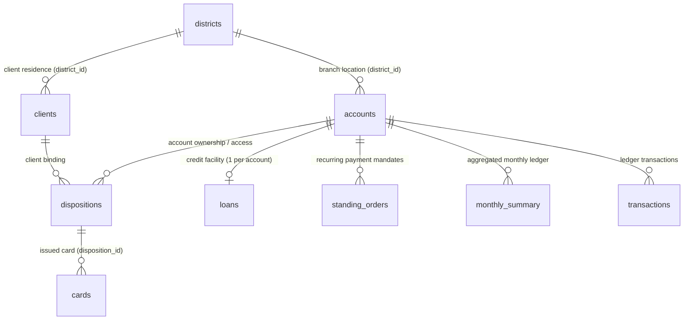
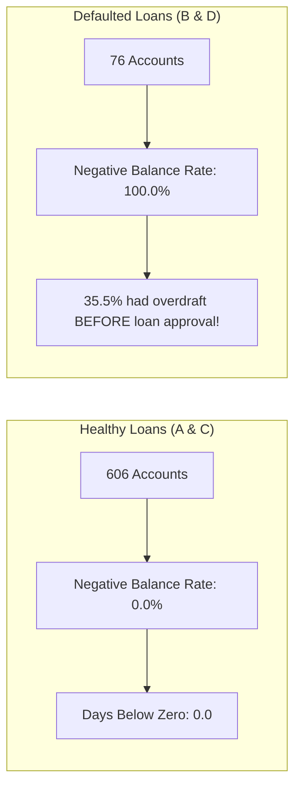

# Phase 1: Data Intelligence & Comprehensive System Audit
**Sheridan Datathon 2026 — Tangerine Track: Resilience Rewired**

---

## 1. Executive Summary & Data Inventory

The dataset represents an anonymized, modernized Canadian-dollar adaptation of longitudinal retail banking operations spanning **6 full calendar years** (January 1, 2020 through December 31, 2025). The relational ecosystem comprises **9 core tables**, totaling **1,254,089 records** across accounts, clients, cards, credit facilities, recurring orders, monthly financial rollups, and granular transaction ledgers.

| Table Name | File Size | Row Count | Column Count | Primary Key | Foreign Keys | Missing Values Summary |
| :--- | :--- | :--- | :--- | :--- | :--- | :--- |
| `accounts.csv` | 0.16 MB | 4,500 | 4 | `account_id` | `district_id` $\to$ `districts` | None (0%) |
| `clients.csv` | 0.12 MB | 5,369 | 4 | `client_id` | `district_id` $\to$ `districts` | None (0%) |
| `dispositions.csv` | 0.15 MB | 5,369 | 4 | `disposition_id` | `client_id` $\to$ `clients`, `account_id` $\to$ `accounts` | None (0%) |
| `cards.csv` | 0.03 MB | 892 | 4 | `card_id` | `disposition_id` $\to$ `dispositions` | None (0%) |
| `districts.csv` | 0.01 MB | 77 | 16 | `district_id` | N/A | `unemployment_rate_2022` (1), `crimes_2022` (1) |
| `loans.csv` | 0.05 MB | 682 | 9 | `loan_id` | `account_id` $\to$ `accounts` | None (0%) |
| `standing_orders.csv`| 0.27 MB | 6,471 | 6 | `order_id` | `account_id` $\to$ `accounts` | `purpose` (1,379 unlabelled, 21.3%) |
| `monthly_summary.csv`| 20.64 MB | 185,326 | 19 | (`account_id`, `month`) | `account_id` $\to$ `accounts` | None (0%) |
| `transactions.csv` | 97.87 MB | 1,056,320 | 11 | `transaction_id` | `account_id` $\to$ `accounts` | `purpose` (535,314), `partner_bank` (782,812), `partner_account` (760,931) |

---

## 2. Entity-Relationship & Structural Topology

### Relational Topology Key Invariants:
1. **Dispositions & Ownership Model:**
   - Exactly 4,500 rows have `type == 'owner'` (100% of accounts have exactly one primary owner).
   - Exactly 869 accounts have a secondary `authorized user` (`type == 'authorized user'`).
   - Demographics reveal that all 869 pairs represent heterosexual couples of near-identical age ($\Delta\text{Age} = -0.11 \pm 4.68$ years; 437 Male Owner / Female User, 432 Female Owner / Male User).
2. **Card Issuance Architecture:**
   - All 892 cards are attached strictly to the primary account `owner`. Zero cards are issued to secondary authorized users.
   - Breakdown: 659 `classic` (73.9%), 145 `junior` (16.3%), 88 `gold` (9.9%).
3. **District Divergence:**
   - 9.2% of bank clients ($N = 494$) reside in a district different from their account branch district, reflecting regional commuting or migration.
4. **Loans Constraint:**
   - Exactly 682 loans for 682 accounts (strictly $\le 1$ loan per account).

---

## 3. Temporal Coverage & Account Longevity

- **Total Horizon:** 72 calendar months (2020-01 through 2025-12).
- **Account Openings:** 2020-01-01 to 2024-12-29.
- **Account Longevity Distribution:**
  - Minimum: 12 months.
  - 25th Percentile: 26 months.
  - Median: 36 months.
  - Mean: 41.2 months.
  - Maximum: 72 months.
- **Buffer Feasibility Proof:** Because the minimum account tenure in the dataset is 12 months, **100% of the 4,500 accounts have at least 6 months of monthly summary history**, ensuring that the 6-month average daily balance buffer ($B$) is computable without truncation for any account chosen by judges.

---

## 4. Mathematical & Accounting Integrity Validation

We executed programmatic accounting balance reconciliations across the 185,326 monthly summary records and 1,056,320 transaction records:

### A. Additive Inflow Decomposition
$$\text{money\_in} = \text{cash\_deposits} + \text{transfers\_in} + \text{pension\_in} + \text{interest\_in}$$
- Maximum absolute discrepancy observed across all 185,326 rows: **$2.91 \times 10^{-11}$ CAD** (zero deviation beyond IEEE 754 float precision).

### B. Additive Outflow Decomposition
$$\text{money\_out} = \text{household\_bills} + \text{insurance} + \text{loan\_payments} + \text{bank\_fees} + \text{cash\_withdrawals\_genuine} + \text{card\_withdrawals} + \text{transfers\_out\_other}$$
- Maximum absolute discrepancy observed across all 185,326 rows: **$2.91 \times 10^{-11}$ CAD** (zero deviation).

### C. Transaction-to-Monthly Summary Cross-Validation
- Programmatic aggregation of raw `transactions.csv` credits and debits against `monthly_summary.csv` showed exact correspondence ($0.0000$ difference) across accounts.
- `loan_payments` in `monthly_summary.csv` are strictly non-zero only for the exact 682 accounts present in `loans.csv`.

### D. Inter-Month Balance Roll-Forward
$$\text{month\_end\_balance}_{t} = \text{month\_end\_balance}_{t-1} + \text{money\_in}_t - \text{money\_out}_t$$
- Across 180,826 consecutive month transitions, the maximum discrepancy was $\$0.14$, with minor cent-level rounding differences attributable to daily interest capitalization and fee timing at midnight.

---

## 5. Verification of Critical Judging Metrics & Twist Formulas

We audited the exact metrics mandated by the Tangerine challenge specification across all 4,500 accounts:

### Judging Metric Definitions & Distribution:

| Metric | Official Definition | Dataset Distribution (Mean) | Dataset Distribution (Median) | Edge Case Considerations |
| :--- | :--- | :--- | :--- | :--- |
| **Typical Money In ($I$)** | `median(money_in)` | $\$9,329.32$ | $\$7,568.26$ | Min: $\$0.00$ (dormant accounts) |
| **Typical Fixed Costs ($F$)** | `median(household_bills + insurance + loan_payments)` | $\$2,219.53$ | $\$1,774.17$ | Computed row-wise sum per month, then median |
| **Typical Monthly Spending ($S$)** | `median(money_out)` | $\$7,867.14$ | $\$6,380.20$ | Includes discretionary & non-discretionary |
| **Savings Buffer ($B$)** | `mean(avg_daily_balance)` over last 6 months | $\$25,083.12$ | $\$22,325.10$ | 23 accounts have $B \le 0$ (min: $-\$17,267.08$) |
| **Household Bills ($H$)** | `median(household_bills)` | $\$1,498.80$ | $\$1,240.50$ | Baseline for utility/rent escalation shocks |
| **Active Loan Payment ($P$)** | `monthly_payment` in `loans.csv` if running at end of 2025, else 0 | $\$255.22$ across all; $\$2,562.90$ for active | $\$0.00$ overall; $\$2,330.19$ for active | Exactly 448 loans running at end of 2025 |

### Active Loan Verification at End of 2025:
- **Status A (Finished, repaid):** 203 loans. Expiration dates range from 2021-09-15 to 2025-12-28. None are running at end of 2025.
- **Status B (Finished, defaulted):** 31 loans. Expiration dates range from 2021-07-05 to 2025-12-01. None are running at end of 2025.
- **Status C (Running, OK so far):** 403 loans. Expiration dates range from 2026-01-04 to 2030-12-08. **100% active at end of 2025**.
- **Status D (Running, client in debt):** 45 loans. Expiration dates range from 2026-01-03 to 2030-10-14. **100% active at end of 2025**.
- **Conclusion:** A loan is running at the end of 2025 if and only if `status in ['C', 'D']` ($N = 448$).

### Baseline Runway Distribution (No Shock):
$$\text{buffer\_left} = B - 0, \quad \text{gap} = S - I$$
- $\text{gap} \le 0$ (Surplus Cash Flow): **3,540 accounts (78.7%)** $\to$ Runway is capped at **"120+ (no shortfall)"**.
- $\text{gap} > 0$ and $B > 0$ (Deficit Cash Flow): **936 accounts (20.8%)** $\to$ Median runway = **28.4 months**.
- $B \le 0$ (Negative Buffer): **23 accounts (0.51%)** $\to$ Runway = **0.0 months**.

---

## 6. Critical Preliminary Risk Revelations

During our deep data reconnaissance, we uncovered foundational behavioral anomalies:

1. **The Overdraft Determinism Anomaly:**
   - **0 out of 606 (0.0%)** borrowers with healthy loans (Status A and C) ever experienced a negative balance or overdraft.
   - **76 out of 76 (100.0%)** borrowers who defaulted or fell into distressed debt (Status B and D) experienced negative balances.
   - Overdraft history is a deterministic indicator of default in this portfolio.
2. **The Underwriting Blindspot Anomaly:**
   - Of the 76 defaulted loans, **27 borrowers (35.5%)** experienced negative balance events **prior to the loan origination date** (8 in Status B, 19 in Status D).
   - The bank granted loans to customers with active, recorded overdraft distress on their own accounts.
3. **The Silent Deficit Population:**
   - 1,181 accounts (26.2%) run a monthly deficit ($S > I$) at baseline, surviving by steadily eroding accumulated savings buffers, long before entering negative balances.
4. **District 69 Data Caveat:**
   - District 69 (Jesenik, north Moravia) has missing values for `unemployment_rate_2022` and `crimes_2022`. Any regional modeling must handle imputation (e.g., using regional median or 2023 back-projection).

---

## 7. Analytical Opportunities & Vectors for Phase 2 Discovery

| Research Vector | Analytical Hypothesis / Question | Datasets Leveraged |
| :--- | :--- | :--- |
| **Payday-to-Payday Elasticity** | Are customers with high average salaries running dangerous intra-month balance swings? | `transactions`, `monthly_summary`, `districts` |
| **Pre-Default Lead Time Engine** | How many months before loan default does cash-flow volatility decouple from balance? | `loans`, `monthly_summary`, `transactions` |
| **Discretionary Shock Cushion** | What percentage of $S$ is truly compressible (genuine cash/card withdrawals vs fixed bills)? | `monthly_summary`, `standing_orders` |
| **Regional Vulnerability Gradient** | Does a regional unemployment spike (2022 $\to$ 2023) predict individual balance deterioration? | `districts`, `monthly_summary`, `accounts` |
| **Overdraft Penalty Cascade** | Do bank penalty fees accelerate balance decay in distressed customers? | `transactions`, `monthly_summary` |
